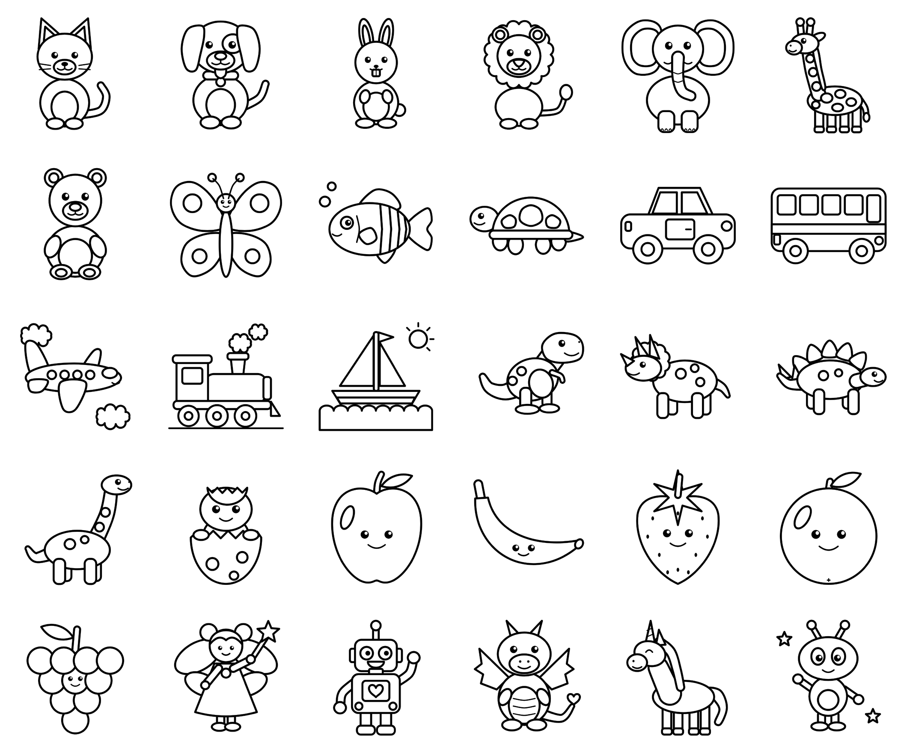

# Colección inicial de dibujos — Pequeños Artistas

> **Actualización (Fase 4):** el catálogo usa ahora el campo `thumbnail`
> (miniaturas de 512 px en `assets/thumbnails/`, generadas con
> `tools/make_thumbnails.py`). Las vistas previas de 1024 px de `assets/previews/`
> quedan solo para control de calidad. Ver [FASE4_COLECCION.md](FASE4_COLECCION.md).

Primera colección de **30 dibujos para colorear** (niños de 4 a 7 años), preparada
para integrarse después en una aplicación Flutter para Android.



## Estado

| Recurso | Estado | Ubicación |
|---|---|---|
| 30 SVG con regiones cerradas e identificadas | ✅ Terminado | `assets/drawings/<categoría>/` |
| 30 PNG 1024×1024 (fondo blanco) | ✅ Terminado | `assets/previews/` |
| Catálogo JSON (31 entradas) | ✅ Terminado | `assets/catalog/catalog.json` |
| Scripts de generación, render y control de calidad | ✅ Terminado | `tools/` |
| Revisión por un ilustrador / prueba con niños | ⏳ Pendiente | — |
| Variante PNG con fondo transparente | ⏳ Pendiente (no se necesita aún) | — |

## Catálogo

| id | Nombre | Categoría | Zonas | Dificultad | Edad | Archivo |
|---|---|---|---:|---|---|---|
| `animal_gato` | Gato | animales | 12 | facil | 4-5 | `assets/drawings/animals/animal_gato.svg` |
| `animal_perro` | Perro | animales | 16 | media | 5-6 | `assets/drawings/animals/animal_perro.svg` |
| `animal_conejo` | Conejo | animales | 9 | facil | 4-5 | `assets/drawings/animals/animal_conejo.svg` |
| `animal_leon` | León | animales | 15 | media | 5-6 | `assets/drawings/animals/animal_leon.svg` |
| `animal_elefante` | Elefante | animales | 14 | media | 5-6 | `assets/drawings/animals/animal_elefante.svg` |
| `animal_jirafa` | Jirafa | animales | 21 | dificil | 6-7 | `assets/drawings/animals/animal_jirafa.svg` |
| `animal_oso` | Oso | animales | 15 | media | 5-6 | `assets/drawings/animals/animal_oso.svg` |
| `animal_mariposa` | Mariposa | animales | 12 | facil | 4-5 | `assets/drawings/animals/animal_mariposa.svg` |
| `animal_pez` | Pez | animales | 10 | facil | 4-5 | `assets/drawings/animals/animal_pez.svg` |
| `animal_tortuga` | Tortuga | animales | 23 | dificil | 6-7 | `assets/drawings/animals/animal_tortuga.svg` |
| `animal_cebra` | Cebra | animales | 30 | dificil | 6-7 | `assets/drawings/animals/animal_cebra.svg` |
| `vehiculo_automovil` | Automóvil | vehiculos | 11 | facil | 4-5 | `assets/drawings/vehicles/vehiculo_automovil.svg` |
| `vehiculo_autobus` | Autobús | vehiculos | 13 | media | 5-6 | `assets/drawings/vehicles/vehiculo_autobus.svg` |
| `vehiculo_avion` | Avión | vehiculos | 12 | facil | 4-5 | `assets/drawings/vehicles/vehiculo_avion.svg` |
| `vehiculo_tren` | Tren | vehiculos | 17 | media | 5-6 | `assets/drawings/vehicles/vehiculo_tren.svg` |
| `vehiculo_barco` | Barco | vehiculos | 8 | facil | 4-5 | `assets/drawings/vehicles/vehiculo_barco.svg` |
| `dinosaurio_01` | Rex sonriente | dinosaurios | 12 | facil | 4-5 | `assets/drawings/dinosaurs/dinosaurio_01.svg` |
| `dinosaurio_02` | Triceratops | dinosaurios | 14 | media | 5-6 | `assets/drawings/dinosaurs/dinosaurio_02.svg` |
| `dinosaurio_03` | Estegosaurio | dinosaurios | 17 | media | 5-6 | `assets/drawings/dinosaurs/dinosaurio_03.svg` |
| `dinosaurio_04` | Braquiosaurio | dinosaurios | 12 | facil | 4-5 | `assets/drawings/dinosaurs/dinosaurio_04.svg` |
| `dinosaurio_05` | Bebé dinosaurio | dinosaurios | 9 | facil | 4-5 | `assets/drawings/dinosaurs/dinosaurio_05.svg` |
| `fruta_manzana` | Manzana | frutas | 4 | facil | 4-5 | `assets/drawings/fruits/fruta_manzana.svg` |
| `fruta_platano` | Plátano | frutas | 3 | facil | 4-5 | `assets/drawings/fruits/fruta_platano.svg` |
| `fruta_fresa` | Fresa | frutas | 3 | facil | 4-5 | `assets/drawings/fruits/fruta_fresa.svg` |
| `fruta_naranja` | Naranja | frutas | 4 | facil | 4-5 | `assets/drawings/fruits/fruta_naranja.svg` |
| `fruta_uvas` | Uvas | frutas | 12 | facil | 4-5 | `assets/drawings/fruits/fruta_uvas.svg` |
| `fantasia_hada` | Hada | fantasia | 20 | media | 5-6 | `assets/drawings/fantasy/fantasia_hada.svg` |
| `fantasia_robot` | Robot amigable | fantasia | 22 | dificil | 6-7 | `assets/drawings/fantasy/fantasia_robot.svg` |
| `fantasia_dragon` | Dragón sonriente | fantasia | 14 | media | 5-6 | `assets/drawings/fantasy/fantasia_dragon.svg` |
| `fantasia_unicornio` | Unicornio | fantasia | 16 | media | 5-6 | `assets/drawings/fantasy/fantasia_unicornio.svg` |
| `fantasia_extraterrestre` | Pequeño extraterrestre | fantasia | 19 | media | 5-6 | `assets/drawings/fantasy/fantasia_extraterrestre.svg` |

- **Zonas** = regiones coloreables sin contar el fondo (que también se puede colorear).
- **Dificultad** se calcula automáticamente: ≤ 12 zonas → `facil` (4-5 años),
  13–20 → `media` (5-6 años), > 20 → `dificil` (6-7 años).
- Cada entrada del JSON incluye los campos pedidos (`id`, `name`, `category`,
  `file`, `difficulty`, `recommended_age`, `description`) y dos extra útiles para
  la app: `preview` (ruta del PNG) y `regions` (número de zonas).
- Todas las rutas son relativas a la raíz del proyecto, igual que las declarará
  `pubspec.yaml` (`assets/drawings/animals/` …).

## Dibujos convertidos de imágenes («Catalogo Imagenes/»)

Siete animales (gato, perro, conejo, león, elefante, jirafa y tortuga) se han sustituido, y
la **cebra** se ha añadido como dibujo 31, a partir de los dibujos de línea que subió el propietario a `Catalogo Imagenes/`. La app colorea por
regiones vectoriales, así que cada PNG se convierte en SVG con
`tools/drawings_from_images.py`.

**Cómo se convierte:**

1. Se encaja la imagen en 1024 × 1024 con margen.
2. Se separa la tinta del papel.
3. Cada zona blanca cerrada pasa a ser una región coloreable, y el exterior, el `fondo`.
4. Las zonas diminutas (brillos de los ojos, huecos entre dedos) quedan blancas y no se
   pueden colorear.
5. Cada región se ensancha 3 px por debajo de la línea, para que el color no deje huecos
   blancos, y la tinta se dibuja encima como detalle negro.

**Ajustes manuales:**

- **Elefante:** tenía una pequeña abertura en la línea del cuerpo. Se cierra con un radio de
  5 px, y la línea dibujada también queda cerrada.
- **Nombres de las regiones:** se asignaron mirando las imágenes numeradas que genera
  `--annotate` (en `build/qa/`). Se usan nombres como `cabeza`, `cuerpo` o `cola`, igual que
  en el resto de la colección, así que los dibujos ya guardados conservan los colores de las
  zonas que siguen existiendo.

**Comprobación:**

- El control de calidad (`validate_assets.py`) da 0 errores. Los avisos de zonas pequeñas
  (dedos, nariz) son del mismo tipo que los del resto de la colección.
- Se colorearon en la app (versión web) el gato, el elefante y la tortuga.

- **Cebra:** la línea exterior de la oreja izquierda acababa suelta junto a la cabeza, así que
  la oreja se unía al fondo. Un cierre general habría partido el cuerpo entre las rayas, por
  lo que se sella con un trazo corto (`SEALS` en el script). Tiene 30 zonas y dificultad
  difícil.

**Licencia:** el propietario debe confirmar que tiene derecho a usar estas imágenes en una
app comercial; la ficha de Google Play las presenta como ilustraciones propias.

```bash
python3 tools/drawings_from_images.py --annotate
```

```bash
python3 tools/drawings_from_images.py
```

```bash
python3 tools/generate_drawings.py
```

Este último ya no sobrescribe los 8 SVG convertidos.

## Estilo gráfico

- Lienzo cuadrado de 1024 × 1024, fondo blanco, composición centrada con un
  margen mínimo de 104 px (el validador exige ≥ 48 px sin trazos en el PNG).
- Contornos negros de **14 px** en las regiones y **10 px** en los detalles
  (≈ 1,4 % del ancho: siguen siendo gruesos al verse en un móvil).
- Solo blanco y negro: sin grises, degradados, texturas, texto, logotipos ni
  marcas de agua (comprobado automáticamente).
- Formas simples y redondeadas, caras sonrientes, nada aterrador ni violento.

## Estructura de cada SVG

```xml
<svg id="animal_gato" viewBox="0 0 1024 1024" width="1024" height="1024">
  <g id="regiones">
    <path id="fondo"  class="region" fill="#FFFFFF" stroke="none" d="…Z"/>
    <path id="cola"   class="region" fill="#FFFFFF" stroke="#000000" stroke-width="14" d="…Z"/>
    <path id="cuerpo" class="region" fill="#FFFFFF" stroke="#000000" stroke-width="14" d="…Z"/>
    …
  </g>
  <g id="detalles" pointer-events="none">
    <!-- ojos, sonrisas, bigotes: decoración negra, no rellenable -->
  </g>
</svg>
```

Reglas que cumple cada archivo (verificadas por `tools/validate_assets.py`):

1. Toda región es **un único `<path>` cerrado** (un solo `M`, termina en `Z`),
   con `id` único dentro del archivo, en minúsculas y sin espacios
   (`oreja_izquierda`, `rueda_delantera`…).
2. Coordenadas absolutas: **sin `transform`**, `<use>`, imágenes incrustadas ni
   fuentes. Cualquier parser de trazados (p. ej. `path_drawing` →
   `parseSvgPathData`) puede leer el atributo `d` directamente.
3. Las regiones están **ordenadas de atrás hacia adelante**. Las formas pueden
   solaparse (la cabeza tapa parte del cuerpo), así que la zona tocada es la
   **última región de la lista que contiene el punto**. La primera es siempre
   `fondo`.
4. Los detalles van en un grupo aparte con `pointer-events="none"` y se pintan
   encima de los colores.

### Cómo usarlo en Flutter (siguiente etapa)

- **Modo vectorial (recomendado):** leer los `<path>` del grupo `regiones`,
  guardar un `Map<String, Color>` por `id`, pintar en un `CustomPainter` cada
  región con su color + contorno, después el grupo `detalles`. Para el toque:
  recorrer las regiones en orden inverso y usar `Path.contains(punto)`.
- **Modo mapa de bits (alternativa):** usar el PNG como lienzo y rellenar por
  inundación (flood fill). Los contornos son continuos, así que el relleno no se
  escapa entre zonas.
- Para dedos pequeños se recomienda una **tolerancia de toque**: si el punto cae
  sobre un contorno, elegir la región más cercana en un radio de ~12 dp, y
  permitir zoom en dibujos de dificultad `media`/`dificil`.

## Control de calidad

Resultado de `python3 tools/validate_assets.py`: **31 dibujos, 0 errores** (tras añadir la cebra).

Se comprueba:

- Exactamente 31 entradas, reparto 11/5/5/5/5 por categoría (era 30 y 10/5/5/5/5 antes de la cebra).
- Sin `id`, nombres ni rutas duplicados; todos los campos obligatorios presentes.
- Cada archivo del catálogo existe, la ruta es relativa y el nombre coincide con
  el `id` (solo `a-z`, `0-9`, `_`).
- Estructura SVG descrita arriba, solo colores `#FFFFFF`/`#000000`, sin
  elementos prohibidos.
- PNG de 1024×1024, en blanco y negro, sin trazos a menos de 48 px del borde.
- **Área visible de cada región** (`tools/measure_regions.mjs` la pinta con un
  color único y cuenta píxeles): ninguna región queda tapada y ninguna mide
  menos de 900 px². Las regiones de 900–2000 px² (narices, pezuñas, botones,
  antenas…; unas 95 en total, sobre todo en la jirafa, el extraterrestre y el
  hada) se listan como **avisos**: se pueden colorear, pero conviene la
  tolerancia de toque o el zoom indicados arriba.

## Cómo regenerar los recursos

Requisitos: Python 3 con Pillow y numpy; Node.js con Playwright y Chromium.

```bash
python3 tools/generate_drawings.py   # SVG + catálogo
node tools/render_previews.mjs       # PNG 1024x1024
node tools/measure_regions.mjs       # áreas por región -> build/qa/
python3 tools/validate_assets.py     # control de calidad
```

Cada dibujo está definido como código en `tools/drawings/<categoría>.py` con
primitivas sencillas (elipses, rectángulos redondeados, curvas suaves, bandas)
de `tools/drawing_lib.py`. Para ajustar un dibujo se edita su función y se
vuelven a ejecutar los cuatro comandos; el generador escala y centra cada
dibujo automáticamente.

## Origen y licencia de los recursos

Los 30 dibujos son **originales**: se construyeron desde cero con figuras
geométricas definidas en el código de este repositorio, sin partir de imágenes,
plantillas, fuentes ni bancos de imágenes de terceros, y sin herramientas de IA
generativa de imágenes. No reproducen personajes ni marcas registradas. Por
tanto pueden distribuirse dentro de la aplicación; queda pendiente que el
titular del proyecto elija y declare la licencia definitiva (por ejemplo,
propietaria o CC0).

## Limitaciones pendientes

- El estilo es geométrico y sencillo (hecho con primitivas por código). Es
  correcto para colorear, pero un ilustrador podría darle más personalidad
  manteniendo la misma estructura de regiones.
- Algunos dibujos de perfil (unicornio, jirafa) son más esquemáticos que los de
  frente; conviene probarlos con niños.
- La dificultad se basa solo en el número de zonas; habría que validarla con
  pruebas reales.
- Aún no hay versión PNG con fondo transparente ni miniaturas más pequeñas;
  se pueden generar con el mismo script de render cuando la app lo necesite.
