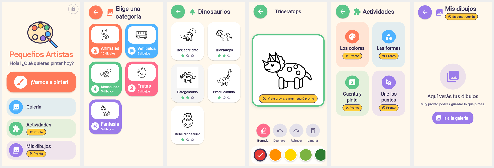
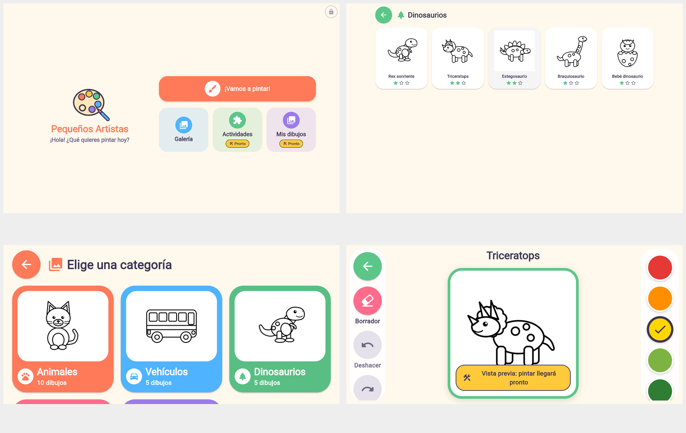

# Fase 2 — Interfaz y navegación

> **Actualización:** la Fase 3 implementó el coloreado real y «Mis dibujos». Lo
> descrito aquí como provisional en esas dos pantallas está superado; ver
> [FASE3_MOTOR.md](FASE3_MOTOR.md).

Aplicación Flutter (Android) creada sobre el repositorio de la Fase 1, reutilizando
sus 30 dibujos y su catálogo. **El coloreado todavía no funciona**: la pantalla de
coloreado es la estructura visual que recibirá el motor en la Fase 3.




*Capturas reales de la app compilada para web (solo para verificar el diseño) con
Chromium a 360×760, 760×360 y 1280×800 dp.*

## Inspección inicial

| Elemento | Resultado |
|---|---|
| Proyecto Flutter previo | No existía (solo recursos de la Fase 1). Se creó con `flutter create --platforms android` en la raíz, sin borrar ni sobrescribir nada (README y `.gitignore` conservados; `.gitignore` ampliado). |
| Flutter / Dart | No estaban instalados. Se instaló Flutter 3.47.8 estable (Dart 3.13.7). |
| Android SDK | No disponible y **no instalable**: la política de red del entorno bloquea `dl.google.com`. |
| Recursos de la Fase 1 | Verificados: 30 SVG, 30 PNG, `catalog.json` con 30 entradas (10/5/5/5/5); `tools/validate_assets.py` → 0 errores. Ninguno falta ni es incompatible. |
| Uso en la app | Las miniaturas y el lienzo usan los PNG (`Image.asset`, sin dependencias nuevas). Los SVG se declaran como assets para el motor de la Fase 3. |

## Pantallas

| Ruta | Pantalla | Estado |
|---|---|---|
| `/` | **Inicio**: logotipo provisional, nombre, bienvenida, botón «¡Vamos a pintar!», Galería, Actividades, Mis dibujos y acceso discreto para adultos | Funcional |
| `/categorias` | **Categorías**: 5 tarjetas con ilustración (dibujo real de la categoría), icono, nombre y número de dibujos | Funcional |
| `/galeria` | **Galería** de una categoría, desde el catálogo; miniatura, nombre y dificultad (estrellas + texto accesible); estado vacío | Funcional |
| `/colorear` | **Coloreado**: lienzo central, paleta de 12 colores, borrador, deshacer, rehacer, limpiar, volver | Solo diseño: elegir color y borrador cambia la selección; deshacer/rehacer/limpiar desactivados; aviso visible «Vista previa: pintar llegará pronto» |
| `/mis-dibujos` | **Mis dibujos** | Provisional, marcada «En construcción» |
| `/actividades` | **Actividades**: Los colores, Las formas, Cuenta y pinta, Une los puntos | Provisional, cada una marcada «Pronto» |
| `/adultos` | **Zona para adultos**: información, estado del catálogo e incidencias, privacidad, estado del desarrollo | Funcional (informativa) |
| *(otra)* | Pantalla segura «Ups, aquí no hay nada» con botón al inicio | Funcional |

- «¡Vamos a pintar!» abre directamente un dibujo fácil (uno distinto en cada pulsación):
  una actividad con un solo toque. Si el catálogo está vacío, lleva a las categorías.
- Acceso para adultos: candado pequeño y poco contrastado en la esquina; un toque no
  hace nada, hay que **mantenerlo pulsado** y resolver una multiplicación (6–9 × 6–9)
  con cuatro opciones. La ruta `/adultos` exige un argumento que solo se crea tras la
  verificación. Usa un tema gris propio y su botón de cierre vuelve al inicio.

## Navegación

`MaterialApp` con `onGenerateRoute` (`lib/navigation/app_router.dart`), sin paquetes
externos. Cada ruta valida su argumento tipado (`GalleryArgs`, `ColoringArgs`,
`AdultZoneArgs`); una ruta desconocida o sin argumento abre la pantalla segura. El
botón «Volver» de cada pantalla (y el botón atrás de Android) regresa siempre a la
pantalla anterior: coloreado → galería → categorías → inicio.

## Arquitectura

```
lib/
  main.dart, app.dart          arranque, tema, rutas, tope de escala de texto
  theme/                       app_colors, app_dimens, app_theme
  models/                      Drawing, Difficulty, DrawingCategory, DrawingCatalog
  services/                    CatalogService (lectura y validación), AppServices
  navigation/                  app_routes (nombres y argumentos), app_router
  screens/                     una pantalla por archivo (8)
  widgets/                     componentes reutilizables
  coloring/                    controlador, lienzo, paleta y barra de herramientas
test/                          37 pruebas
```

**Componentes reutilizables:** `KidScaffold` (cabecera con volver + título + marca),
`KidIconButton` (botón redondo ≥ 64 dp con icono, etiqueta y semántica),
`BigActionButton`, `MenuTile` (vertical u horizontal), `ComingSoonBadge`,
`CategoryCard`, `DrawingCard`, `DrawingThumbnail` + `MissingImagePlaceholder`,
`EmptyState`, `AdaptiveGrid` (columnas según el ancho), `CatalogBuilder`,
`AppLogo`, `EraserIcon`, `showAdultGate`.

**Lectura del catálogo (`CatalogService`).** Lee `assets/catalog/catalog.json` una
vez (caché) y contrasta cada ruta con el `AssetManifest` real. Nunca lanza
excepciones a la interfaz: descarta entradas sin SVG, con categoría desconocida,
id duplicado, campos ausentes o rutas inseguras (`..`, absolutas, URL), y marca
como «sin vista previa» los dibujos cuyo PNG falta (se muestra un marcador
«Imagen pendiente»). Las incidencias se ven en la zona para adultos.

**Preparado para la Fase 3.** `ColoringController` ya expone `color`, `tool`,
`canUndo`, `canRedo`, `hasColoring`, `undo()`, `redo()`, `clear()` y
`coloringEngineReady` (hoy `false`). `ColoringCanvas` es el único widget que hay que
sustituir: recibirá el `Drawing` (con la ruta del SVG) y el controlador. Al
activar el motor, los botones se habilitan solos y el aviso de vista previa
desaparece.

## Accesibilidad y seguridad infantil

- Objetivos táctiles de 64 dp (botones), 60 dp (colores) y tarjetas grandes.
- Nada depende solo del color: iconos + etiquetas en herramientas, palomita y anillo
  en el color elegido, estrellas para la dificultad, etiqueta semántica en todo.
- Se respeta el tamaño de texto del sistema hasta ×1,6 (probado sin desbordes).
- Sin datos personales, publicidad, compras, chat ni enlaces externos; sin permiso
  de internet adicional en el código de la app.
- Transiciones suaves (fundido) y sin animaciones intensas.
- Diseño adaptable: inicio en una o dos columnas, rejillas de 2 a 5 columnas, y
  coloreado con paleta inferior (vertical) o lateral (horizontal).

## Pruebas ejecutadas (resultados reales)

| Comprobación | Resultado |
|---|---|
| `flutter analyze` | Sin incidencias |
| `flutter test` | **37/37 aprobadas** |
| Catálogo real | 30 dibujos, 0 incidencias, todos los SVG/PNG existen, reparto 10/5/5/5/5, carpetas declaradas en `pubspec.yaml` |
| Lectura robusta | JSON inválido, catálogo ausente, SVG ausente, PNG ausente, categoría desconocida, id duplicado, ruta insegura |
| Navegación | Inicio → coloreado → volver; las 5 categorías → galería (cuenta 10/5/5/5/5 tarjetas) → volver; galería → dibujo → volver; Mis dibujos; Actividades; zona de adultos (toque, respuesta incorrecta y correcta); rutas desconocidas y sin argumentos; dibujo inexistente |
| Estados vacíos e imágenes | Categoría vacía, catálogo vacío, PNG ausente y PNG que no carga → marcador «Imagen pendiente» |
| Coloreado (diseño) | Todos los controles presentes; selección de color y borrador; deshacer/rehacer/limpiar desactivados; aviso de vista previa |
| Tamaños de pantalla | 7 pantallas × 5 tamaños (320×568 a 1280×800, vertical y horizontal) × texto ×1,0 y ×1,6, sin desbordamientos |
| Visual | Compilación web (`flutter build web`, solo para verificación, en copia temporal) y capturas con Chromium en 3 tamaños |

### Pendiente de verificar

- **Compilar el APK y probar en un emulador o dispositivo Android**: no fue posible
  porque el entorno no puede descargar el Android SDK (`dl.google.com` bloqueado).
- Pruebas con niños reales (comprensión de iconos, tamaño de los objetivos).

## Cómo ejecutar

Requisitos: Flutter 3.47 (Dart 3.13) y Android SDK con un emulador o dispositivo.

```bash
flutter pub get
flutter analyze
flutter test
flutter run            # con un dispositivo Android conectado o un emulador
flutter build apk      # APK de depuración/publicación
```

Nota: `tools/measure_regions.mjs` (Fase 1) guarda su resultado en `build/qa/`;
`flutter clean` borra esa carpeta, basta con volver a ejecutar el script.
