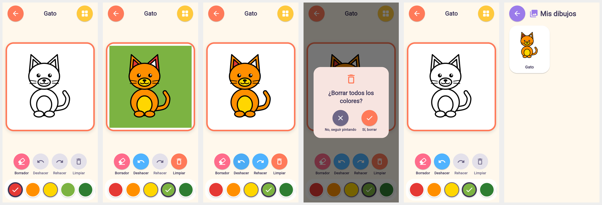
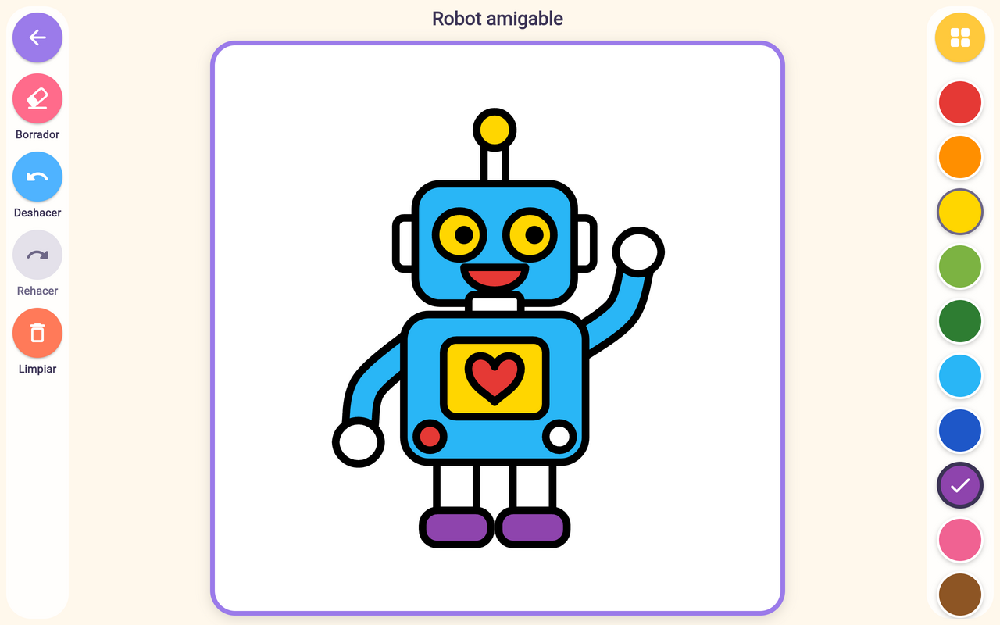

# Fase 3 — Motor real de coloreado

El niño elige un dibujo, elige un color y toca una zona: **solo esa zona se
rellena**, los contornos negros quedan intactos y el progreso se guarda en el
dispositivo. Verificado con pruebas automáticas sobre los 30 dibujos y con clics
reales en Chromium (compilación web usada solo para verificar).


*Gato pintado → deshacer dos pasos → confirmación de «Limpiar» → dibujo limpio →
«Mis dibujos» con la miniatura guardada.*


*Robot en tableta horizontal: zonas pequeñas (botón, corazón dentro del panel) pintadas con precisión.*

## Inspección inicial

| Elemento | Resultado |
|---|---|
| Catálogo | `CatalogService` (Fase 2) lee `catalog.json` y verifica cada ruta con el `AssetManifest`. Se reutiliza sin cambios. |
| Formatos reales | 30 SVG (1024×1024) con un grupo `regiones` de `<path>` cerrados con `id` único y un grupo `detalles`; comandos usados: `M L C Q A Z`. 30 PNG solo de vista previa. |
| Pantalla de la Fase 2 | Paleta, herramientas y lienzo existían como diseño, con un controlador preparado (`canUndo`, `undo()`, `clear()`...). Se conservaron el diseño y la navegación. |
| Comprobaciones previas | `flutter analyze` sin incidencias, 37/37 pruebas, `validate_assets.py` 0 errores. |

## Decisión técnica: regiones vectoriales (opción A)

Se eligió **colorear las regiones del SVG** y se descartó el relleno por
inundación sobre PNG:

- Los SVG ya traen exactamente lo necesario: cada zona es un trazado cerrado con
  identificador. Cambiar su color es cambiar un valor en un mapa `id → color`:
  imposible que el color «se escape» a una zona vecina.
- Los contornos se dibujan **siempre después** del relleno de su región, así que
  nunca quedan tapados.
- Detectar la zona tocada es `Path.contains` (nativo en Skia/Impeller) sobre
  ~10–30 trazados, precalculados una vez con su rectángulo envolvente: menos de
  1 ms por toque, sin búferes de píxeles en memoria.
- El dibujo se escala sin pérdida a cualquier pantalla y el progreso se guarda
  como datos (`región → color`), independientes de la resolución.
- El relleno sobre PNG obligaría a guardar mapas de bits por dibujo, tratar el
  antialiasing de los bordes y recalcular en cada toque; no aporta nada aquí
  porque los vectores existen. **No se mezclan las dos técnicas**: los PNG solo
  se usan como miniaturas en la galería.

No se añadió ningún paquete SVG: el lector propio (`svg_drawing_parser.dart`)
acepta solo el formato controlado de la Fase 1 y rechaza cualquier desviación
(transform, `<use>`, colores no planos, regiones abiertas, ids duplicados) con
un error manejable en lugar de dibujar algo incorrecto.

## Arquitectura

```
lib/coloring/
  engine/
    svg_path_parser.dart     atributo d → Path (M L H V C S Q T A Z, absolutos y relativos)
    svg_drawing_parser.dart  SVG de la Fase 1 → VectorDrawing (valida el formato)
    vector_drawing.dart      regiones en orden + detalles; hitTest con tolerancia
    drawing_painter.dart     CustomPainter: escala/centra, rellena, contornea, detalles
  coloring_history.dart      ColorEdit (antes/después por región) + pila con límite (100)
  coloring_controller.dart   estado de UNA sesión de coloreado (sin widgets)
  coloring_canvas.dart       lienzo: toque → coordenadas del dibujo → controlador
  color_palette_bar.dart     paleta (13 colores) con indicador del activo
  coloring_toolbar.dart      borrador, deshacer, rehacer, limpiar
  palette.dart
lib/services/
  drawing_loader.dart        carga + caché LRU (6 dibujos); los fallos no se cachean
  progress_store.dart        SavedProgress (formato v1) + almacén shared_preferences / memoria
lib/screens/
  coloring_screen.dart       sesión por dibujo, confirmación de limpiar, «Otro dibujo»
  saved_drawings_screen.dart «Mis dibujos» con miniaturas pintadas (antes provisional)
```

**Estado (`ColoringController`)**: id del dibujo activo, estado de carga
(`loading/ready/error`) y mensaje de error, región seleccionada (última tocada),
color y herramienta activos, colores por región, historial de deshacer/rehacer y
`hasUnsavedChanges`. Es lógica pura, probada sin interfaz.

**Rendimiento**: los trazados se analizan una vez por dibujo (≈1 ms cada uno,
medido en las pruebas) y se cachean. Un toque solo repinta el `CustomPaint`
(con `RepaintBoundary`); la pantalla no se reconstruye, solo la paleta y la
barra de herramientas escuchan al controlador. Sin parpadeos: el color se aplica
en el siguiente fotograma.

## Comportamiento

- **Pintar**: tocar una zona la rellena con el color activo; volver a tocarla con
  otro color la cambia; cambiar de color no altera lo ya pintado.
- **Paleta**: rojo, naranja, amarillo, verde claro, verde, celeste, azul, morado,
  rosa, marrón, gris, negro y blanco. Botones de 60 dp; el activo lleva anillo
  oscuro y palomita. El **blanco devuelve la zona a su estado original**.
- **Borrador**: devuelve la zona tocada a su estado original.
- **Deshacer / rehacer**: cada toque es un paso; «limpiar» es un único paso
  (también se puede deshacer). Un cambio nuevo descarta lo que se podía rehacer.
  Tocar una zona con el mismo color no crea pasos vacíos.
- **Limpiar**: pide confirmación con dos botones grandes con icono («No, seguir
  pintando» / «Sí, borrar»). Restaura los colores originales; el SVG nunca se
  modifica.
- **Otro dibujo**: abre una hoja con los dibujos de la misma categoría; el dibujo
  actual se guarda y el nuevo empieza con su propio estado (una sesión nueva por
  dibujo, con clave por id: no se pueden mezclar colores).
- **Toques imprecisos**: la zona es la que se ve bajo el dedo (la última región
  que contiene el punto, igual que en el SVG). Si el dedo cae en el fondo a
  menos de 12 dp de una figura, se elige esa figura (votación de 16 puntos de
  muestra). Los toques fuera del dibujo (bandas laterales) no pintan nada.
- **Errores**: un SVG ausente o dañado muestra «No pudimos abrir este dibujo» con
  botón «Reintentar»; las herramientas quedan desactivadas y se puede volver.

## Guardado del progreso

> **Actualización (Fase 5):** este formato (v1) se sustituyó por creaciones v2
> con copia de seguridad y migración automática; ver [FASE5_GUARDADO.md](FASE5_GUARDADO.md).

`shared_preferences` (paquete oficial de flutter.dev; almacenamiento privado de la
app). Una clave por dibujo, `progress.v1.<id>`:

```json
{
  "format_version": 1,
  "drawing_id": "animal_gato",
  "updated_at": "2026-10-29T10:15:00.000Z",
  "regions": { "cuerpo": "#FFFF8F00", "barriga": "#FFFFD600" }
}
```

- Se guarda automáticamente 0,6 s después del último cambio, al salir del dibujo y
  cuando la app pasa a segundo plano.
- Un dibujo limpio borra su entrada. El historial de deshacer no se guarda.
- Datos dañados, de otra versión o con regiones que ya no existen se ignoran sin
  bloquear al niño; un fallo del almacenamiento no impide pintar (se reintenta).
- «Mis dibujos» lista los dibujos empezados (más recientes primero) con su
  miniatura pintada, y se actualiza cuando el almacén avisa de un cambio.

## Dibujos

**Los 30 dibujos funcionan con el motor.** No es una muestra: la prueba
`test/coloring/all_drawings_test.dart` comprueba, en cada uno de los 30:

1. que el SVG se lee, el número de zonas coincide con el catálogo y los ids son únicos;
2. que todas las regiones son tocables (barrido de 65 536 puntos) y que ninguna
   visible mide menos de 800 u² (la menor: `dinosaurio_03/mancha_2`, ≈1984 u²);
3. que tocar **cada una de sus regiones** (408 en total, contando los fondos)
   pinta esa región y no cambia ninguna otra.

**Dibujos que requieren correcciones: ninguno** para que el coloreado funcione.
Mejoras recomendadas (no bloqueantes) para dedos pequeños, ya listadas en la
Fase 1 como avisos: las zonas más pequeñas (≈ 2000 u², unos 18 dp de lado en un
teléfono) están en la jirafa (pezuñas, cuernos, punta de la cola), el robot
(botones), el extraterrestre (antenas), el estegosaurio (manchas) y el plátano
(punta). Agrandarlas en `tools/drawings/*.py` y regenerar mejoraría la comodidad;
mientras tanto la tolerancia de 12 dp ayuda en los bordes.

## Pruebas (resultados reales)

`flutter analyze`: sin incidencias. `flutter test`: **141 pruebas aprobadas**.

| Requisito | Pruebas |
|---|---|
| 1. Tocar rellena con el color elegido | controlador (por id y por coordenadas), widget del lienzo, juego completo |
| 2. Las vecinas no cambian | controlador; los 30 dibujos región por región |
| 3. Contornos visibles | render a imagen y lectura de píxeles: bordes negros tras pintar; en el gato real, el número de píxeles negros no cambia al pintar todas las zonas |
| 4. Cambiar de color varias veces | controlador, juego completo |
| 5. Borrador (y blanco) | controlador, juego completo |
| 6. Deshacer/rehacer | controlador (incluye descartar rehacer y límite de 100 pasos), juego completo |
| 7. Limpiar | controlador (y deshacer el limpiado), juego completo con confirmación |
| 8. Cambiar de dibujo sin mezclar | controlador, juego completo con «Otro dibujo» |
| 9. Recuperar lo guardado | almacén en memoria y `shared_preferences` real (plataforma simulada), formato JSON, guardado diferido y al cerrar, «Mis dibujos» |
| 10. Coordenadas al redimensionar | lienzos de 300×300, 700×450, 360×640 y 1200×900; el robot real a dos tamaños; horizontal en la app |
| 11. Regiones pequeñas y límites | tolerancia junto a una figura pequeña, borde compartido (una sola región), toque fuera del dibujo |
| 12. Recursos faltantes | SVG ausente, SVG dañado, fallo del almacenamiento, reintento del cargador; error amable en la app |

Además siguen pasando las pruebas de la Fase 2 (catálogo, navegación, estados
vacíos y 5 tamaños de pantalla × 2 escalas de texto, ahora con el lienzo real).

**Verificación visual**: compilación web en una copia temporal y clics reales con
Chromium en teléfono (380×800) y tableta (1280×800). Ver capturas arriba.

## Limitaciones conocidas

- **No se ha compilado el APK ni se ha probado en Android**: el entorno no puede
  descargar el Android SDK (`dl.google.com` bloqueado). `shared_preferences`
  incluye código nativo Android que solo se verifica al compilar.
- **Lectores de pantalla**: el lienzo se anuncia como «Dibujo para colorear»,
  pero la acción de toque de accesibilidad pulsa su centro; no hay todavía una
  forma accesible de elegir cada zona por nombre.
- No hay zoom ni desplazamiento en el lienzo (útil para las zonas más pequeñas).
- El historial de deshacer se pierde al salir del dibujo (los colores no).
- No hay herramienta de pincel libre: el coloreado es por zonas.
- Solo se admite el formato SVG controlado de la Fase 1 (es intencionado).

## Cómo ejecutar y probar

```bash
flutter pub get
flutter analyze
flutter test                                   # 141 pruebas
flutter test test/coloring/all_drawings_test.dart   # solo los 30 dibujos
flutter run                                    # en un emulador o móvil Android
```

En la app: «¡Vamos a pintar!» (o Galería → categoría → dibujo) → elige un color →
toca una zona. Prueba «Deshacer», «Rehacer», «Borrador», el blanco, «Limpiar» y
«Otro dibujo»; sal y vuelve a entrar (o abre «Mis dibujos») para ver el progreso
guardado.
