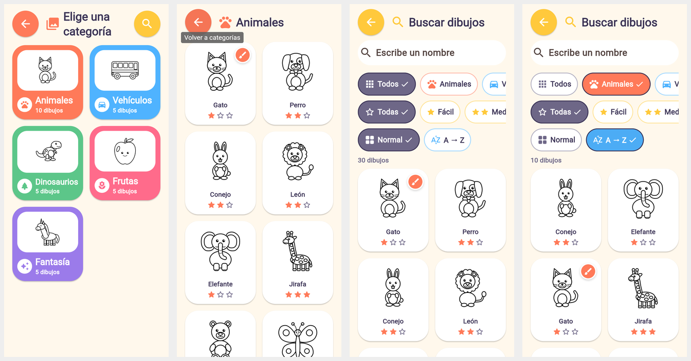

# Fase 4 — Integración de los 30 dibujos y catálogo interactivo

**30 de 30 dibujos integrados, 0 pendientes.** Cada uno existe, se carga, abre su
propio archivo desde la galería, carga sus regiones, se puede colorear zona por
zona y guarda su progreso por separado. Todo verificado con pruebas automáticas
(resultados abajo); nada de esto está simulado.


*Capturas reales (compilación web solo para verificar, Chromium 400×860):
categorías con su número de dibujos · galería de Animales con la insignia de
pincel en el gato ya pintado · búsqueda con los 30 dibujos · búsqueda filtrada
(Animales) en orden A→Z.*

## Inspección inicial

| Elemento | Resultado |
|---|---|
| Catálogo | `assets/catalog/catalog.json`, 30 entradas válidas (10/5/5/5/5), sin duplicados. Usaba `preview` (PNG 1024 px) como imagen de la galería. |
| SVG | 30 archivos en `assets/drawings/<categoría>/`, todos compatibles con el motor de la Fase 3. Sin duplicados por contenido. |
| PNG | 30 vistas previas 1024×1024 (1,7 MB). La app las empaquetaba enteras y las reducía al decodificar. |
| Motor y pruebas | 141/141 pruebas, análisis limpio, `validate_assets.py` con 0 errores. |
| `Catalogo Imagenes/` | 2 PNG subidos por el usuario (ver «Recursos no integrados»). |

## Estado por categoría

| Categoría | Dibujos (dificultad, zonas) | Estado |
|---|---|---|
| Animales (10) | Gato (fácil, 11) · Perro (media, 14) · Conejo (media, 13) · León (media, 13) · Elefante (fácil, 9) · Jirafa (difícil, 28) · Oso (media, 15) · Mariposa (fácil, 12) · Pez (fácil, 10) · Tortuga (fácil, 11) | ✅ 10/10 |
| Vehículos (5) | Automóvil (fácil, 11) · Autobús (media, 13) · Avión (fácil, 12) · Tren (media, 17) · Barco (fácil, 8) | ✅ 5/5 |
| Dinosaurios (5) | Rex sonriente (fácil, 12) · Triceratops (media, 14) · Estegosaurio (media, 17) · Braquiosaurio (fácil, 12) · Bebé dinosaurio en el huevo (fácil, 9) | ✅ 5/5, cinco diseños distintos |
| Frutas (5) | Manzana (fácil, 4) · Plátano (fácil, 3) · Fresa (fácil, 3) · Naranja (fácil, 4) · Uvas (fácil, 12) | ✅ 5/5 |
| Fantasía (5) | Hada (media, 20) · Robot amigable (difícil, 22) · Dragón sonriente (media, 14) · Unicornio (media, 16) · Pequeño extraterrestre (media, 19) | ✅ 5/5 |

Dificultad: ≤ 12 zonas → fácil (4-5 años), 13–20 → media (5-6), > 20 → difícil
(6-7). Hay 18 fáciles, 10 medias y 2 difíciles: una colección adecuada para 4-7
años, con la mayoría accesible a los más pequeños.

## Cambios en el catálogo

Formato normalizado (versión 2), un único archivo central:

```json
{
  "id": "animal_gato",
  "name": "Gato",
  "category": "animales",
  "file": "assets/drawings/animals/animal_gato.svg",
  "thumbnail": "assets/thumbnails/animal_gato.png",
  "difficulty": "facil",
  "recommended_age": "4-5",
  "regions": 11,
  "description": "Gatito sentado de frente con orejas puntiagudas, bigotes y cola curvada."
}
```

- `preview` pasa a llamarse **`thumbnail`** y apunta a la miniatura real. Los ids
  y las rutas de los SVG no cambian (el progreso guardado sigue valiendo). El
  lector de Flutter acepta todavía `preview` como nombre antiguo.
- Errores de formato con mensajes controlados (visibles en la zona para adultos):
  JSON inválido, catálogo ausente, campos vacíos, categoría o dificultad
  desconocidas, id duplicado, ruta insegura, SVG o miniatura ausentes.

## Miniaturas y rendimiento

- **Miniaturas reales**: `tools/make_thumbnails.py` reduce cada render de 1024 px a
  **512×512 en escala de grises** (Lanczos). Son cuadradas como el original y se
  muestran con `BoxFit.contain`: nunca se estiran. Total: 608 KB frente a 1,7 MB.
- **La app solo empaqueta las miniaturas** (`assets/thumbnails/`); las vistas
  previas de 1024 px siguen en el repositorio para el control de calidad, pero ya
  no se incluyen en el APK.
- Cada miniatura se decodifica al tamaño que ocupa en pantalla (múltiplos de
  128 px, máximo 512) mediante `cacheWidth`; la **caché de imágenes estándar de
  Flutter** (`ImageCache`) reutiliza la imagen decodificada entre tarjetas y
  pantallas. No hay una caché propia adicional.
- Las rejillas son perezosas (`GridView.builder` / `SliverGrid`): solo se
  construyen las tarjetas visibles.
- Si una miniatura falta o no se puede decodificar, aparece el marcador
  «Imagen pendiente».

## Galería, búsqueda y filtros

- **Categorías**: tarjeta grande por categoría con ilustración, icono, color propio
  y número de dibujos. Nuevo botón grande **«Buscar dibujos»** (lupa).
- **Galería**: las tarjetas muestran miniatura, nombre y dificultad (estrellas) y
  una **insignia con un pincel** en los dibujos que tienen colores guardados
  (también se anuncia como «ya pintado» a los lectores de pantalla). Se actualiza
  al volver de pintar. Estado vacío amable si una categoría no tiene dibujos.
- **Búsqueda** (pantalla aparte para no complicar la galería):
  - campo de texto grande y opcional; busca en el nombre y en la categoría sin
    distinguir mayúsculas ni tildes («leon» encuentra «León»);
  - filtros con botones grandes con icono: categoría (Todos + 5), dificultad
    (Todas + estrellas) y orden (Normal / A → Z);
  - contador de resultados y estado vacío con «Quitar filtros».
- La lógica de filtrado (`DrawingFilter`) es independiente de la interfaz.

## Integración con el motor de coloreado

Comprobado para **los 30** dibujos:

1. Tocar la tarjeta abre ese dibujo y no otro: el `drawingId` de la pantalla, el
   título y las regiones cargadas en el lienzo coinciden con el SVG del catálogo.
2. Las regiones cargadas conservan sus identificadores y su orden.
3. Tocar cada región la pinta sin cambiar ninguna otra (408 regiones).
4. El progreso se guarda con el id del dibujo y no se mezcla entre dibujos.

## Pruebas (resultados reales)

`flutter analyze`: sin incidencias. `flutter test`: **162 pruebas aprobadas**.
`python3 tools/validate_assets.py`: 30 dibujos, 0 errores, 95 avisos (zonas de
900–2000 px², ya documentadas en la Fase 1).

| Requisito | Prueba |
|---|---|
| Exactamente 30 entradas | `catalog_integrity_test` |
| 10/5/5/5/5 y nombres exactos por categoría; 5 dinosaurios distintos | `catalog_integrity_test` |
| Ids, nombres, archivos y miniaturas sin repetir; sin duplicados por contenido ni archivos huérfanos | `catalog_integrity_test` |
| Todas las rutas existen y son coherentes con id y categoría | `catalog_integrity_test`, `catalog_service_test` |
| Las miniaturas se decodifican (512×512) | `catalog_integrity_test` |
| Sin campos obligatorios vacíos | `catalog_integrity_test` |
| Cada tarjeta abre el dibujo correcto (las 30) | `gallery_integration_test` |
| Filtros (texto, tildes, categoría, dificultad, A-Z, combinados) | `drawing_filter_test`, `gallery_integration_test` |
| Compatibilidad con el motor (las 30, región por región) | `coloring/all_drawings_test` |
| Los estados guardados no se mezclan | `gallery_integration_test`, `coloring/coloring_controller_test`, `coloring/coloring_game_test` |
| Sin desbordamientos (incluida la búsqueda) en 5 tamaños × 2 escalas de texto | `responsive_test` |

## Recursos corregidos

- **Ningún dibujo tuvo que corregirse**: los 30 SVG ya eran compatibles. Se
  regeneraron con el generador sin ningún cambio (diferencias en git: ninguna).
- **Catálogo**: campo `preview` → `thumbnail`, versión 2.
- **Miniaturas**: nuevas (`assets/thumbnails/`), sustituyen a las vistas previas de
  1024 px dentro de la app.

## Recursos no integrados

`Catalogo Imagenes/Gato kawaii para colorear.png` y `Catalogo Imagenes/Perrito
tierno para colorear.png` (subidos al repositorio durante la Fase 2):

- representan un gato y un perro, que **ya existen** en la colección
  (`animal_gato`, `animal_perro`): añadirlos crearía entradas duplicadas;
- son **imágenes rasterizadas** (1536×1024, no cuadradas) sin regiones, así que el
  motor vectorial no puede colorearlas; convertirlas automáticamente a SVG está
  descartado (Fase 1) porque no garantiza regiones cerradas;
- sus nombres tienen espacios y su origen/licencia no consta en el proyecto.

Se dejan intactos y fuera del catálogo. Si se quieren usar como nuevas versiones
del gato y el perro, habría que redibujarlos como SVG con regiones (o vectorizarlos
y revisar a mano cada región) y sustituir los actuales manteniendo sus ids.

## Problemas detectados

- Ninguno bloqueante en la colección.
- Las filas de filtros se desplazan en horizontal en teléfonos estrechos (el
  chip cortado sugiere que hay más); en tabletas caben completas.
- Las miniaturas de la galería son el dibujo sin colorear; la insignia indica que
  está empezado (las miniaturas con color están en «Mis dibujos»).
- Sigue pendiente compilar el APK y probar en Android: el entorno no puede
  descargar el Android SDK (`dl.google.com` bloqueado).

## Cómo ejecutar

```bash
flutter pub get
flutter test
flutter run
```

Para regenerar los recursos gráficos tras editar un dibujo:

```bash
python3 tools/generate_drawings.py
node tools/render_previews.mjs
python3 tools/make_thumbnails.py
node tools/measure_regions.mjs
python3 tools/validate_assets.py
```
