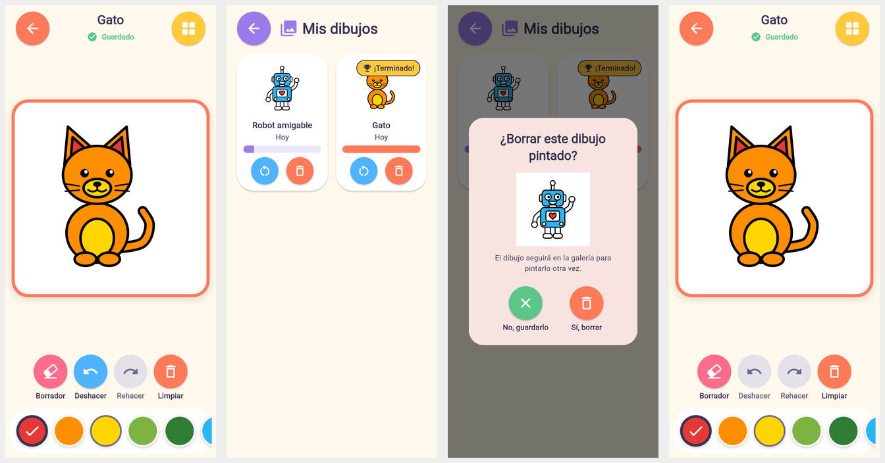

# Fase 5 — Guardado local, galería personal y progreso

El niño colorea, sale y, al volver (incluso tras cerrar la app), encuentra su
dibujo con los mismos colores en «Mis dibujos». Todo se guarda **solo en el
dispositivo**, sin cuentas ni red. Verificado con pruebas automáticas y en
Chromium recargando la página.


*Capturas reales (compilación web solo para verificar): el gato pintado con el
indicador «Guardado» · «Mis dibujos» **después de recargar la página** (robot en
progreso y gato «¡Terminado!») · confirmación de borrado con la miniatura ·
el gato reabierto con sus colores.*

## Inspección inicial

- La Fase 3 ya guardaba el progreso en `shared_preferences` con el formato 1:
  una clave por dibujo (`progress.v1.<dibujo>`), guardado diferido de 0,6 s, al
  salir de la pantalla y al pasar a segundo plano.
- Faltaba: varias creaciones por dibujo («nueva versión»), estado del dibujo,
  protección frente a escrituras incompletas, migración del formato, borrar con
  confirmación e informe de datos dañados (antes se ignoraban en silencio).
- Los 30 ids del catálogo son estables (`animal_gato`, `dinosaurio_03`…). El
  flujo galería → `ColoringScreen` y el motor se reutilizan sin cambios.
- El manifiesto principal de Android no pide permiso de internet y no hay
  paquetes de red.

## Arquitectura de persistencia

```
lib/persistence/
  creation.dart           Creation: modelo, estado, progreso, formato v2 con suma de verificación
  key_value_backend.dart  KeyValueBackend: SharedPreferencesBackend (app) / MemoryBackend (pruebas, con fallos simulados)
  creation_store.dart     CreationStore / KeyValueCreationStore: copia de seguridad, verificación,
                          recuperación, migración v1 → v2, informe de problemas
lib/coloring/
  coloring_controller.dart  sesión de UNA creación; guardado automático; SaveState
  save_indicator.dart       «Guardado» / «Guardando…» / «No se guardó · Reintentar»
lib/screens/
  saved_drawings_screen.dart  «Mis dibujos»
  coloring_screen.dart        abre la creación pedida, la más reciente o una nueva
  adult_zone_screen.dart      apartado «Dibujos guardados»
```

- **Creación** = colores aplicados a un dibujo del catálogo. Un dibujo puede
  tener varias creaciones («Pintar otra vez»). Desde la galería se continúa la
  más reciente; desde «Mis dibujos», la elegida.
- **Guardado automático** (`ColoringController`): cada toque marca cambios
  pendientes y programa una escritura a los **0,6 s** (los toques seguidos se
  agrupan). Además se guarda **al salir de la pantalla** y **cuando la app pasa a
  segundo plano** (`AppLifecycleListener.onHide`), así que no depende del cierre
  de la app, que el sistema puede matar sin avisar. Las escrituras no se solapan.
- Una creación sin colores no se guarda (si existía, se borra su entrada).
- **Estado**: `sin_comenzar` (sin colores), `en_progreso`, `terminado`.
  «Terminado» es fiable: se conoce cada zona del dibujo, y se marca solo cuando
  todas (sin contar el fondo) tienen color.

## Ubicación y formato de los datos

- **Dónde**: almacenamiento privado de la app mediante `shared_preferences`
  (`SharedPreferencesAsync`; en Android usa Jetpack DataStore, dentro del
  directorio de datos de la app). En la web, `localStorage` del navegador.
- **Claves**: `creation.v2.<id>` (creación) y `creation.v2.<id>.bak` (versión
  válida anterior). `<id>` = `<dibujo>-<marca de tiempo><aleatorio>`.
- **Contenido**:

```json
{
  "format_version": 2,
  "id": "animal_gato-mh9x2k1a3f9q",
  "drawing_id": "animal_gato",
  "created_at": "2026-10-29T10:12:00.000Z",
  "updated_at": "2026-10-29T10:15:31.000Z",
  "total_regions": 11,
  "painted_regions": 7,
  "status": "en_progreso",
  "regions": { "barriga": "#FFFFD600", "cabeza": "#FFFF8F00", "fondo": "#FF29B6F6" },
  "checksum": "8c1d47a2"
}
```

- Unos cientos de bytes por creación. **No se guardan imágenes.**

## Seguridad de los datos y recuperación

| Situación | Qué hace la app |
|---|---|
| Guardado normal | La versión válida actual se copia a `.bak` y **se verifica**; después se escribe la nueva y **se vuelve a leer** para comprobarla. |
| Escritura de la copia interrumpida | Se aborta antes de tocar la principal, que sigue válida. |
| Escritura de la principal interrumpida | La lectura detecta el error (JSON incompleto o suma que no coincide), usa la copia `.bak` y **repara** la principal. |
| Principal ausente con copia válida | Se recupera desde la copia. |
| Datos ilegibles (principal y copia) | No se muestran como creación, **no se borran**. La zona para adultos los cuenta y permite eliminarlos con confirmación. |
| Dibujo que ya no existe en el catálogo | La creación se conserva y no se muestra; la zona para adultos lo indica. |
| Colores o zonas desconocidas | Las zonas que no existen en el dibujo se ignoran al abrirlo. Un color mal formado invalida el registro (suma de verificación). |
| Formato antiguo (v1) | **Migración automática**: cada `progress.v1.<dibujo>` se convierte en una creación v2. La clave antigua solo se borra tras verificar la nueva; si no se puede leer, se conserva y se informa. Si falla a mitad, se reintenta en la siguiente operación. Las versiones futuras seguirán el mismo esquema (claves por versión y migración verificada). |
| Error de lectura o escritura | `StorageException`; la app no se bloquea. Al pintar: indicador «No se guardó · Reintentar» (se reintenta también en el próximo cambio y al salir). En «Mis dibujos»: «No pudimos abrir tus dibujos» con «Reintentar». |

**Nunca se borran datos del usuario de forma automática ante un error.**

## Pantallas creadas o modificadas

- **«Mis dibujos»**: tarjetas grandes con la **miniatura en color**, el nombre,
  la fecha amable («Hoy», «Ayer», «Hace 3 días»), una **barra de progreso** y la
  insignia «¡Terminado!». Tocar la tarjeta continúa el dibujo; botones grandes
  «Pintar otra vez» (nueva versión desde el original) y «Borrar» (confirmación con
  la miniatura, «No, guardarlo» / «Sí, borrar», y aviso de que el dibujo sigue en
  la galería). Mensaje vacío: «¡Tu galería te espera!». Sin puntuaciones.
- **Lienzo**: indicador de guardado bajo el título; tocarlo guarda en el acto.
- **Zona para adultos**: apartado «Dibujos guardados» con recuento, recuperados,
  creaciones de dibujos retirados, datos dañados y su eliminación confirmada.

**Miniaturas**: se reconstruyen pintando el SVG con los colores guardados (mismo
pintor que el lienzo). Siempre reflejan el último estado, mantienen la proporción
cuadrada, no ocupan espacio y no pueden faltar ni quedar desactualizadas; si el
SVG no se pudiera cargar se muestra un icono de imagen rota.

## Privacidad

- Sin cuentas, sin datos personales, sin analítica, sin servidores y sin
  sincronización: el código de la app no usa la red (comprobado en pruebas) y el
  manifiesto principal no pide permiso de internet.
- **Copia automática de Android desactivada** (`android:allowBackup="false"`):
  por defecto Android puede subir los datos de la app a la cuenta de Google del
  dispositivo; se desactiva porque esta versión no debe enviar datos fuera.
- **Borrar los datos de la app o desinstalarla elimina las creaciones** (también
  en la web, borrar los datos del sitio).

## Pruebas (resultados reales)

`flutter analyze`: sin incidencias. `flutter test`: **196 pruebas aprobadas**.

| Requisito | Prueba |
|---|---|
| 1-3. Guardar varias zonas, cerrar y volver a abrir, colores exactos | `persistence_flow_test` (reinicio real de la app sobre el mismo almacenamiento), `creation_store_test`, `coloring_controller_test` |
| 4. Dos dibujos sin mezclarse | `creation_store_test`, `persistence_flow_test`, `gallery_integration_test` |
| 5. Actualizar una creación (una sola entrada, copia de la anterior) | `creation_store_test`, `persistence_flow_test` |
| 6. Aparece en «Mis dibujos» (nombre, fecha, progreso, «¡Terminado!») | `persistence_flow_test` |
| 7. La miniatura se actualiza | `persistence_flow_test` (colores de la miniatura antes y después) |
| 8. Borrar sin afectar al catálogo ni a otras creaciones; confirmación | `creation_store_test`, `persistence_flow_test` |
| 9. Datos dañados o incompletos | `creation_store_test` (escrituras truncadas, copia, reparación, ilegibles conservados, migración v1), `persistence_flow_test` (no se muestran; adulto los elimina con confirmación) |
| 10. Fallos de almacenamiento | `creation_store_test`, `coloring_controller_test`, `persistence_flow_test` (indicador y reintento; aviso en «Mis dibujos») |
| 11. Estado al navegar y al pasar a segundo plano | `persistence_flow_test` |
| 12. Sin internet | `persistence_flow_test` (`HttpOverrides` que bloquea la red: 0 intentos; sin permiso INTERNET ni paquetes de red; copia en la nube desactivada) |
| «Pintar otra vez» | `persistence_flow_test` |

## Limitaciones conocidas

- **No se ha probado en un dispositivo Android**: el entorno no puede descargar el
  Android SDK (`dl.google.com` bloqueado). La verificación es con pruebas de
  Flutter (con la plataforma de `shared_preferences` simulada) y en Chromium.
- La atomicidad final de cada escritura depende de la plataforma (DataStore en
  Android escribe en un archivo temporal y lo renombra); la copia de seguridad y
  la verificación cubren los fallos que la app puede detectar.
- El historial de deshacer no se guarda (los colores sí).
- No hay exportación ni copia manual de las creaciones (p. ej., a la galería de
  fotos); si se desinstala la app, se pierden.

## Cómo probar el guardado en Android

1. Instala la app: `flutter run` (o `flutter install`) con el móvil conectado.
2. Pinta varias zonas de un dibujo y espera a ver «Guardado» bajo el título.
3. **Salida normal**: vuelve atrás → «Mis dibujos» muestra la tarjeta.
4. **Cierre forzado**: pinta otra zona, pulsa el botón de inicio del móvil
   (la app pasa a segundo plano y guarda), luego ciérrala desde «recientes» o con
   `adb shell am force-stop com.pequenosartistas.pequenos_artistas`. Ábrela:
   el dibujo debe conservar el último color.
5. **Sin conexión**: activa el modo avión y repite los pasos 2-4.
6. **Nueva versión y borrado**: en «Mis dibujos», «Pintar otra vez» y «Borrar»
   (prueba «No, guardarlo» y «Sí, borrar»); comprueba que el dibujo sigue en la
   galería.
7. **Borrado de datos**: Ajustes → Apps → Pequeños Artistas → Almacenamiento →
   Borrar datos: las creaciones desaparecen (comportamiento esperado y documentado).

## Recomendaciones para proteger las creaciones

- Añadir en la zona para adultos una **exportación manual** (p. ej., guardar una
  imagen del dibujo en la galería de fotos o compartirla) para que la familia
  decida qué conservar fuera de la app.
- Si en el futuro se quiere copia en la nube, evaluarlo primero (privacidad,
  consentimiento parental, normativa como COPPA/RGPD) antes de activar la copia
  automática de Android o cualquier sincronización.
- Mantener las migraciones de formato verificadas y probadas en cada cambio.
- Probar en dispositivos Android reales de gama baja (escrituras y cierres
  forzados) antes de publicar.
