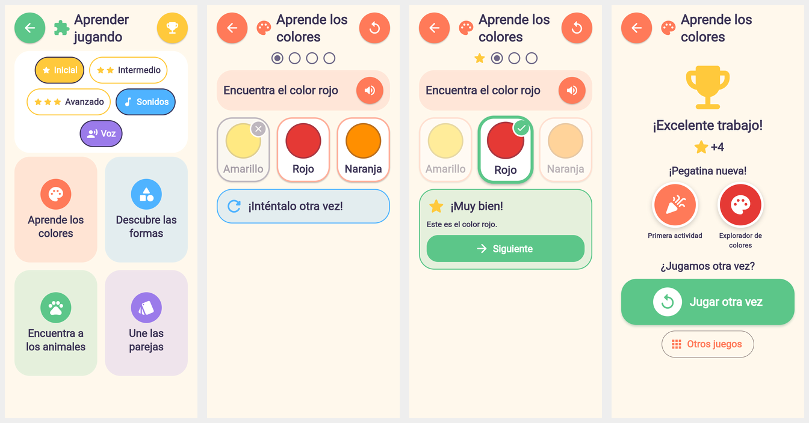
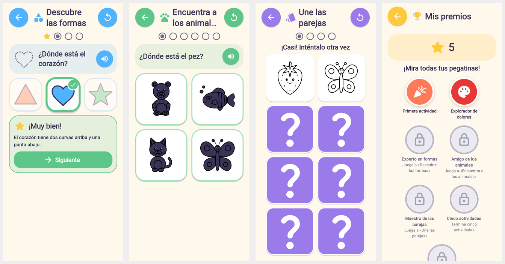

# Fase 6 — «Aprender jugando»: colores, formas, animales, parejas, sonidos y premios

La sección provisional «Actividades» de la Fase 2 pasa a ser **«Aprender jugando»**:
cuatro minijuegos completos, tres niveles, sonidos y voz con controles reales,
pegatinas y estrellas guardadas en el dispositivo. Todo funciona sin conexión.


*«Aprender jugando» con nivel, sonidos y voz · error («¡Inténtalo otra vez!», la opción
queda marcada con ✗) · acierto con explicación y «Siguiente» · actividad completada
con estrellas y pegatinas nuevas.*


*Formas con el contorno como modelo · animales en silueta (nivel avanzado) ·
parejas tras un intento fallido · «Mis premios».*

Capturas reales de la app compilada para web (solo para verificar) en Chromium
400×860; la página no registró ningún error.

## Inspección inicial y cambios en fases anteriores

- Arquitectura: `AppServices` (servicios inyectados), rutas validadas en
  `AppRouter`, persistencia de la Fase 5 (`KeyValueBackend` + `shared_preferences`).
  Se reutilizan sin cambios de diseño.
- «Actividades» era una pantalla provisional (4 tarjetas «Pronto» sin juego): se
  sustituye. La ruta `/actividades` se conserva y el botón del inicio pasa a
  llamarse «Aprender jugando».
- No había audio. Se añadieron `audioplayers` (efectos) y `flutter_tts` (voz).
  Ninguno declara permisos de Android.
- **Correcciones en código anterior** (encontradas al hacer esta fase):
  1. `main()` usaba un plugin antes de `WidgetsFlutterBinding.ensureInitialized()`:
     la app **fallaba al arrancar** (visto en Chromium; habría pasado en Android).
     Corregido y cubierto con una prueba que ejecuta el `main()` real.
  2. Al leer datos guardados, una fecha con un tipo inesperado lanzaba una
     excepción en lugar de tratarse como dato no válido (`Creation.decode` de la
     Fase 5 y el progreso nuevo). Corregido y probado.
  3. Accesibilidad: las pegatinas se fusionaban en un único nodo para los lectores
     de pantalla; ahora cada una se anuncia por separado.

## Los cuatro minijuegos

| Juego | Cómo funciona | Nivel inicial | Intermedio | Avanzado |
|---|---|---|---|---|
| **Aprende los colores** | «Encuentra el color rojo»; círculos de color **con su nombre escrito** (no depende solo del color) | 6 colores básicos, 3 opciones, 4 preguntas | 11 colores, 4 opciones, 5 preguntas | 11 colores, 4 opciones con colores parecidos (rojo/rosa, azul/celeste…), 6 preguntas |
| **Descubre las formas** | «¿Dónde está el triángulo?»; formas dibujadas con vectores en colores variados; al acertar, una explicación («El triángulo tiene 3 lados y 3 puntas») | círculo, cuadrado, triángulo, estrella y corazón; contorno de la forma como modelo | las 7 formas; con modelo | las 7, sin modelo y con formas parecidas (cuadrado/rectángulo, círculo/óvalo) |
| **Encuentra a los animales** | «¿Dónde está el gato?» con las miniaturas del catálogo (sin duplicar imágenes); al acertar, una frase sobre el animal | 10 animales, 3 opciones | 4 opciones | 4 opciones **en silueta**, generadas con el propio dibujo vectorial (verificadas visualmente: se reconocen) |
| **Une las parejas** | Cartas con dibujos del catálogo; las parejas quedan descubiertas con ✓; si no coinciden se ocultan tras 1,2 s con «¡Casi! Inténtalo otra vez» | 2 parejas | 4 parejas | 6 parejas |

En todos: un error **nunca** resta nada, se puede volver a intentar hasta acertar,
no hay tiempo límite ni vidas, el avance es con un botón «Siguiente» (sin prisa) y
cada juego se puede reiniciar («Empezar de nuevo») o repetir al terminar
(«Jugar otra vez»). El nivel se elige con tres botones grandes en «Aprender
jugando» (por defecto, inicial; no se pide la edad).

## Sonidos y voz: estado real

- **Efectos de sonido: implementados.** Cuatro WAV propios generados por
  `tools/make_sounds.py` (tonos suaves, −12 dBFS, 0,1–0,95 s, 92 KB en total,
  sin licencias de terceros): toque, acierto, «inténtalo otra vez» (neutro) y
  celebración. Se reproducen con `audioplayers` a volumen moderado y los
  reproductores se liberan al salir de «Aprender jugando».
- **Voz: implementada con el motor de texto a voz del dispositivo** (`flutter_tts`,
  español; ritmo pausado y tono amable). Lee la instrucción al empezar cada
  pregunta, el elogio y la explicación al acertar («¡Lo encontraste! …»),
  «¡Inténtalo otra vez!» y «¡Excelente trabajo! ¿Jugamos otra vez?». El botón
  «Escuchar» repite la instrucción. Se calla al salir de un juego. No descarga
  nada: si el dispositivo no tiene una voz en español instalada, no se oye y la
  app sigue funcionando con texto e iconos.
- **Controles reales:** «Sonidos» y «Voz» se activan o desactivan por separado,
  se guardan y se respetan (con la voz apagada desaparece «Escuchar»).
- **Verificación:** en las pruebas automáticas el audio se sustituye por
  dobles que registran cada sonido y frase, y se comprueba qué suena, cuándo y que
  las preferencias se respetan. **No se ha podido escuchar en un dispositivo real**
  (sin Android SDK en este entorno; en Chromium headless no hay salida de audio).
- Pendiente: no hay voces grabadas por una persona (el entorno no tiene motor de
  síntesis ni banco de voces con licencia); se usa la voz del sistema.

## Recompensas y progreso: estado real

- **Estrellas**: una por pregunta acertada o pareja encontrada.
- **Pegatinas** (ids estables): `primera_actividad`, `explorador_colores`,
  `experto_formas`, `amigo_animales`, `maestro_parejas`, `cinco_actividades` y
  `todos_los_juegos`. Se consiguen **terminando actividades**, con errores o sin
  ellos. Se guardan como un mapa id → fecha: no pueden duplicarse ni perderse al
  repetir.
- **«Mis premios»**: estrellas y pegatinas; las que faltan, en gris con una pista
  amable. Sin clasificaciones ni comparaciones, sin compras ni publicidad.
- **Progreso por juego**: partidas terminadas, preguntas/parejas acumuladas y
  última partida. Una partida abandonada suma lo acertado, pero no cuenta como
  terminada.

## Persistencia

Mismo almacenamiento local que la Fase 5, con claves propias que no interfieren
con las creaciones (`creation.v2.*`):

- `learning.v1.state` — preferencias (sonidos, voz, nivel), progreso por juego,
  pegatinas, estrellas y última actividad, en JSON con suma de verificación.
- `learning.v1.state.bak` — versión válida anterior (copia verificada antes de
  sobrescribir; se verifica también la escritura nueva).
- `learning.v1.state.damaged` — si todo estuviera dañado, se conserva aquí una
  copia y se empieza de cero (nunca se borra en silencio).
- Los campos ausentes o con tipos no válidos toman su valor por defecto sin perder
  el resto. Si guardar falla, se sigue jugando con los datos en memoria y se
  reintenta en el siguiente guardado. La zona para adultos muestra un resumen.

## Arquitectura

```
lib/learning/
  learning_level.dart        niveles y GameId (ids estables)
  learning_content.dart      colores, formas, animales, tamaños por nivel, cartas
  games/quiz_game.dart       motor de preguntas (lógica pura, compartido por 3 juegos)
  games/memory_game.dart     lógica de parejas
  quiz_specs.dart            lo propio de cada juego de preguntas + siluetas
  rewards.dart               pegatinas y sus condiciones
  learning_progress.dart     modelo guardado (preferencias, progreso, premios)
  learning_store.dart        persistencia con copia de seguridad y verificación
  learning_controller.dart   estado global; concede premios una sola vez
  audio/learning_audio.dart  efectos (audioplayers), voz (flutter_tts), preferencias
  screens/                   hub, juego de preguntas, parejas, premios, lanzador
  widgets/                   AnswerOption, InstructionCard, FeedbackPanel,
                             QuestionProgress, ActivityComplete, RewardSticker,
                             LearningSettingsBar, ShapeView
tools/make_sounds.py         genera assets/sounds/*.wav
```

## Pruebas (resultados reales)

`flutter analyze`: sin incidencias. `flutter test`: **233 pruebas aprobadas** (37 nuevas
de esta fase y las 196 anteriores, todas siguen pasando). `validate_assets.py`:
30 dibujos, 0 errores.

| Requisito | Prueba |
|---|---|
| Los 4 minijuegos se abren y se juegan de principio a fin | `learning_games_flow_test` (colores, formas, animales, parejas en 3 niveles) |
| Preguntas y opciones correctas; error sin castigo; avance; reinicio | `games_logic_test`, `learning_games_flow_test` (se equivoca a propósito en cada partida) |
| Parejas: coincidencias, ocultar tras la pausa, final | `games_logic_test`, `learning_games_flow_test` |
| Resultado final y premios una sola vez | `learning_progress_test`, `learning_games_flow_test` (segunda partida sin pegatinas nuevas) |
| Progreso, premios y preferencias tras reiniciar la app | `learning_progress_test`, `learning_games_flow_test` |
| Un juego no altera otro; datos de la Fase 5 intactos | `learning_progress_test`, `learning_games_flow_test` (pintar, jugar, «Mis dibujos») |
| Datos dañados o incompletos; fallo de almacenamiento | `learning_progress_test`, `creation_store_test` |
| Sonidos y voz: activar/desactivar, «Escuchar», liberar al salir | `learning_games_flow_test` |
| Nivel avanzado con siluetas y más opciones | `learning_games_flow_test` |
| Sin red | `learning_games_flow_test` (`HttpOverrides` que bloquea la red: 0 intentos) |
| Pantallas sin desbordamientos (hub, 4 juegos, premios) en 5 tamaños × 2 escalas de texto | `responsive_test` |
| El `main()` real arranca | `app_startup_test` |
| Visual (botones grandes, texto legible, nada cortado) | capturas en Chromium (arriba) |

## Limitaciones y pendientes

- **Sin prueba en un dispositivo Android** (el entorno no puede descargar el
  Android SDK: `dl.google.com` bloqueado). Sonido y voz no se han escuchado.
- La voz depende de que el dispositivo tenga una voz en español.
- Tras ocultar dos cartas que no coinciden, un toque durante la breve animación de
  giro (0,2 s) no cuenta; hay que volver a tocar.
- No hay voces grabadas por personas.

## Cómo probar

```bash
flutter pub get
flutter test
flutter run
```

En la app: «Aprender jugando» → elige nivel → juega (prueba a equivocarte) →
«Mis premios». Cierra la app y vuelve a abrirla para ver que se conservan el
nivel, los sonidos y las pegatinas. Para regenerar los sonidos:
`python3 tools/make_sounds.py`.
