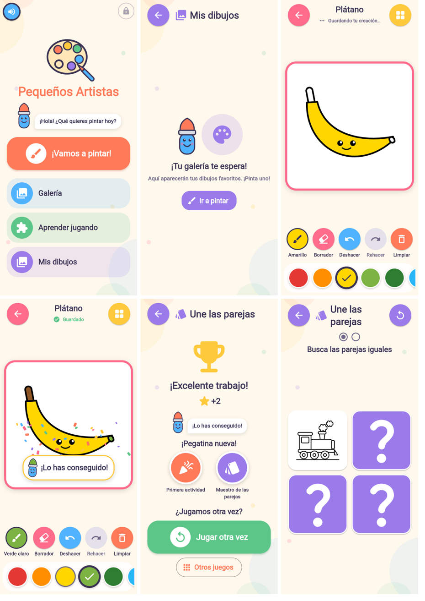

# Fase 7: animaciones, efectos, sonidos y experiencia premium

En esta fase se pule la sensación de la app sin cambiar lo que ya funcionaba:
- transiciones suaves;
- botones que responden al tocarlos;
- un relleno animado al colorear;
- celebraciones breves;
- una mascota original;
- mejores sonidos;
- estados de carga y vacíos más amables.

Todo funciona sin conexión, respeta el ajuste de «reducir movimiento» del sistema
y no usa paquetes nuevos.



*Las capturas son, de izquierda a derecha y de arriba abajo:*
1. *Inicio, con Pincelín y el botón global de sonido.*
2. *«Mis dibujos» vacío, con la mascota.*
3. *Relleno recién aplicado y «Guardando tu creación…».*
4. *Dibujo terminado, con confeti y mensaje.*
5. *Actividad completada, con la mascota y las pegatinas nuevas.*
6. *Juego de parejas con una carta girada.*

Son capturas reales de la app compilada para web (solo para verificar), hechas en
Chromium a 400×860. La página no registró ningún error.

## Diagnóstico inicial

- Había pocas animaciones:
  - el desvanecimiento por defecto entre pantallas;
  - la escala de las respuestas;
  - el giro de las cartas, que era un `AnimatedSwitcher`;
  - el trofeo final.
- Solo 3 sitios respetaban «reducir movimiento».
- El audio tenía 4 efectos y solo sonaba en «Aprender jugando». Colorear era
  silencioso y el control de sonido solo estaba en el menú de juegos.
- Las cargas mostraban un indicador genérico al instante, aunque durasen milisegundos.
- **Problemas encontrados y corregidos:**
  1. **Accesibilidad.** Los botones propios envolvían su contenido en
     `Semantics(excludeSemantics: true)` sin la acción «tocar», así que un lector de
     pantalla (TalkBack) los anunciaba como botones pero no podía activarlos. Ahora
     todos declaran `onTap` (y el acceso de adultos, `onLongPress`). Afectaba a 13
     componentes: tarjetas, menús, colores, respuestas, cartas, interruptores, chips de
     búsqueda, el cambio de dibujo y el botón de adultos.
  2. **Acciones duplicadas.** Dos activaciones seguidas, por ejemplo desde el lector
     de pantalla, abrían dos veces la misma pantalla. Ahora `guardRoute` solo deja
     actuar a la pantalla que está en primer plano. Los toques con el dedo en el mismo
     fotograma ya los bloquea el `Navigator` de Flutter.
  3. **Toques perdidos en las parejas.** Al tocar una carta mientras se daba la
     vuelta, el toque se perdía: `AnimatedSwitcher` mantenía la cara antigua encima. La
     nueva carta tiene un único hijo y el toque depende del estado real.

## Componentes nuevos

| Archivo | Qué hace |
|---|---|
| `lib/theme/app_motion.dart` | Duraciones (rápida 120 ms, media 240 ms, lenta 380 ms) y curvas comunes. `AppMotion.reduced(context)` lee «reducir movimiento». |
| `lib/widgets/motion/pressable.dart` | `Pressable` encoge el elemento al pulsarlo sin quitarle el toque. `guardRoute` evita acciones duplicadas. |
| `lib/widgets/motion/kid_page_transitions.dart` | Transición entre pantallas: fundido y un leve deslizamiento (280 ms al entrar, 220 ms al salir). Con movimiento reducido, solo fundido. |
| `lib/widgets/motion/staggered_entrance.dart` | Las primeras 12 tarjetas de cada rejilla entran escalonadas (45 ms entre tarjetas, máximo 270 ms). Las demás aparecen sin animar. |
| `lib/widgets/motion/delayed_loading.dart` | El indicador de carga solo aparece si la espera supera 300 ms. Lleva un mensaje y no parpadea en las cargas rápidas. |
| `lib/widgets/motion/celebration.dart` | `ConfettiBurst` (36 piezas, 1,6 s, una vez), `RisingStars` (0,9 s) y `Shake` (0,32 s, ±6 px). |
| `lib/widgets/mascot.dart` | **Pincelín**: un pincel sonriente original, dibujado con vectores. Saluda 1 o 2 veces y se queda quieto. `MascotBubble` le añade un bocadillo. |
| `lib/widgets/doodle_background.dart` | Fondo de manchas de pintura muy suaves. Es estático y va aislado en un `RepaintBoundary`. |

Ninguna animación es infinita: todas terminan solas y sus controladores se liberan
en `dispose`. Las únicas animaciones continuas son el `CircularProgressIndicator`
estándar, mientras dura la carga.

## Colorear

- **Relleno animado sin perder precisión.**
  - El color se aplica al instante en el modelo, así que guardar, deshacer y
    comprobar si el dibujo está terminado no esperan a la animación.
  - El pintor dibuja el color anterior y, encima, un círculo del color nuevo que
    crece desde el punto tocado (260 ms). Ese círculo queda **recortado por el
    trazado de la propia región**.
  - Los contornos y los detalles se pintan siempre después, así que nunca quedan
    tapados.
  - Con movimiento reducido, el relleno es inmediato.
- **Herramienta actual** (primer botón de la barra): un círculo con el color y su
  nombre, o el borrador. Cambia con una transición corta.
- **Paleta**: el color elegido crece un poco y suena un «clic» suave.
- **Guardado**: el indicador cambia con un fundido. «Guardando tu creación…» pasa a
  «Guardado» y suena un sonido al guardar a mano.
- **Celebración al terminar.** Se lanza cuando la última zona sin color recibe
  color.
  - Muestra confeti, a Pincelín con la punta del color actual y un mensaje que va
    rotando: «¡Lo has conseguido!», «¡Qué gran trabajo!», «¡Tu creatividad es
    genial!» y «¡Sigue creando!».
  - Dura unos 3 s, no bloquea los toques y sale **una sola vez**: no se repite al
    repintar un dibujo terminado ni al volver a abrirlo.

## Aprender jugando

- **Preguntas.**
  - Cada pregunta entra con un fundido, sin dos preguntas a la vez en pantalla.
  - El modelo (color, forma o animal) aparece con un pequeño salto.
  - Al fallar, las opciones se sacuden suavemente una vez, y nunca al pasar de
    pregunta.
  - Al acertar, suben unas estrellas.
- **Parejas.**
  - Las cartas giran sobre su eje: a mitad de giro cambia la cara.
  - Al encontrar una pareja, las cartas dan un pequeño latido.
  - Una carta que se está dando la vuelta ya se puede tocar.
- **Actividad completada.**
  - Salen el trofeo, unas estrellas que suben y Pincelín con un mensaje que va
    rotando.
  - Las pegatinas nuevas aparecen con un salto.
  - El **confeti y el sonido de premio** solo salen si hay una pegatina **nueva**.
    Como los premios ya conseguidos nunca se repiten, tampoco se repite la
    celebración.

## Sonidos

| Efecto | Cuándo suena | Prioridad |
|---|---|---|
| `tap` | Al girar una carta | normal |
| `select` (nuevo) | Al elegir un color o el borrador | normal |
| `pop` (nuevo) | Al rellenar una zona | normal |
| `correct` / `try_again` | Al acertar o fallar | normal |
| `saved` (nuevo) | Al guardar a mano | normal |
| `celebrate` | Al terminar un dibujo o una actividad | **importante** |
| `reward` (nuevo) | Al conseguir una pegatina nueva | **importante** |

- Hay **un único reproductor**, y cada efecto detiene el anterior, así que nunca
  suenan varios a la vez.
- Durante 900 ms tras un efecto importante se ignoran los normales: un toque no
  corta una celebración.
- Volumen moderado (0,5).
- Los 8 WAV son propios, generados con `tools/make_sounds.py`, y ocupan 168 KB en
  total.
- **Botón global de sonido** en el inicio, arriba a la izquierda. Usa el mismo
  ajuste guardado que «Aprender jugando», así que silencia también los efectos al
  colorear.

## Galería, inicio y estados

- **Inicio**: Pincelín saluda con el bocadillo «¡Hola! ¿Qué quieres pintar hoy?».
- **Rejillas** (categorías, galería, búsqueda, «Mis dibujos» y juegos): las tarjetas
  entran escalonadas.
- **Cargas**:
  - «Preparando tus colores…» para el catálogo.
  - «Buscando tus dibujos…» en «Mis dibujos».
  - «Abriendo tu dibujo…» en el lienzo.

  Solo aparecen si la espera es larga.
- **«Mis dibujos» vacío**: Pincelín y el mensaje «Aquí aparecerán tus dibujos
  favoritos. ¡Pinta uno!».

## Accesibilidad y rendimiento

- **Reducir movimiento** (`MediaQuery.disableAnimations`). Con este ajuste:
  - no hay confeti ni estrellas, ni sacudidas o saltos;
  - las transiciones son solo un fundido;
  - el relleno y el giro de las cartas son inmediatos.

  Los mensajes y los sonidos se mantienen.
- **Sin destellos**: nada parpadea rápido, y el confeti se mueve despacio y se
  desvanece.
- **Lector de pantalla.** Todos los botones propios tienen ahora la acción «tocar».
  Las celebraciones se anuncian como región viva, y la mascota se describe como
  «Pincelín, la mascota».
- **Rendimiento.**
  - El lienzo y el confeti van en un `RepaintBoundary`.
  - El pintor se reutiliza y solo se repinta mientras dura la animación del
    relleno.
  - Las rejillas solo animan las tarjetas iniciales.
  - El fondo es estático.

## Archivos

- **Nuevos:**
  - `lib/theme/app_motion.dart`;
  - `lib/widgets/mascot.dart`;
  - `lib/widgets/doodle_background.dart`;
  - `lib/widgets/motion/` (`pressable`, `kid_page_transitions`,
    `staggered_entrance`, `delayed_loading` y `celebration`);
  - `assets/sounds/` (`select`, `pop`, `saved` y `reward` en `.wav`);
  - `test/motion_test.dart`;
  - este documento.
- **Modificados:**
  - **Colorear:** `coloring_canvas`, `coloring_controller`, `drawing_painter`,
    `color_palette_bar`, `coloring_toolbar` y `save_indicator`.
  - **Aprender jugando:** `learning_audio`, `quiz_game_screen`,
    `memory_game_screen`, `activity_complete`, `answer_option` y
    `learning_settings_bar`.
  - **Pantallas:** `home_screen`, `saved_drawings_screen`, `search_screen` y
    `coloring_screen`.
  - **Componentes:** `adaptive_grid`, `catalog_builder`, `empty_state`,
    `kid_scaffold`, `kid_icon_button`, `menu_tile`, `big_action_button`,
    `category_card` y `drawing_card`.
  - **Servicios y tema:** `app_services` (`maybeOf`) y `app_theme` (transiciones).
  - **Herramientas:** `tools/make_sounds.py`.

## Pruebas (resultados reales)

`flutter analyze`: sin avisos. `flutter test`: **246 pruebas superadas** (233 de antes
y 13 nuevas), con tres ejecuciones seguidas sin fallos. Las nuevas pruebas, en
`test/motion_test.dart`, comprueban que:

1. un doble toque rápido abre una sola pantalla;
2. con el lector de pantalla, los botones se activan y una doble activación abre una
   sola pantalla. Esta prueba falla si se quita `guardRoute`; se comprobó;
3. el color se aplica al instante mientras el relleno se anima, solo cambia la zona
   tocada y suena `pop`;
4. la celebración sale una vez al terminar, y no al repintar ni al reabrir desde
   «Mis dibujos»;
5. con movimiento reducido, colorear y las parejas funcionan sin animación de relleno
   ni excepciones;
6. una carta que se está dando la vuelta se puede volver a tocar;
7. el premio nuevo suena una vez y la celebración no se repite;
8. «Mis dibujos» vacío muestra la mascota y el mensaje;
9. el indicador de carga solo aparece pasados 300 ms;
10. el botón de sonido del inicio silencia también los efectos al colorear;
11. en la prioridad del audio (con un reloj simulado), un toque no corta una
    celebración, un premio sí suena tras una celebración y, con el sonido
    desactivado, no suena nada (3 pruebas).

También se probó en el navegador: la app compilada para web, manejada con Playwright,
recorrió inicio, «Mis dibujos», galería, colorear y terminar el plátano, y una
partida completa de parejas, sin errores de página. Las capturas de arriba salen de
ese recorrido.

## Limitaciones y pendientes

- **No se ha probado en un Android real**: el entorno no tiene el SDK de Android
  porque `dl.google.com` está bloqueado. El sonido y la voz con plugins tampoco se
  han oído aquí. Las pruebas usan sustitutos que registran qué suena.
- **TalkBack real**: las acciones de accesibilidad están verificadas en pruebas de
  widgets, pero conviene comprobarlas en un dispositivo.
- En la web, la captura del relleno a mitad de animación salió casi terminada: el
  relleno dura 260 ms. La animación está comprobada en la prueba 3.
- No hay vibración (*haptics*): se dejó fuera para no añadir comportamiento
  dependiente del dispositivo sin poder probarlo.

## Cómo probar

```bash
flutter pub get
flutter analyze
flutter test
flutter run            # en un Android con depuración USB
```

En el dispositivo, comprobad que:
- al tocar una zona, el color crece desde el dedo;
- al terminar un dibujo salen confeti, la mascota y un mensaje, y no se repiten al
  reabrirlo;
- al fallar una pregunta, las opciones se sacuden;
- las cartas giran;
- con *Ajustes → Accesibilidad → Quitar animaciones* todo funciona sin movimiento;
- el botón de sonido del inicio silencia la app.
