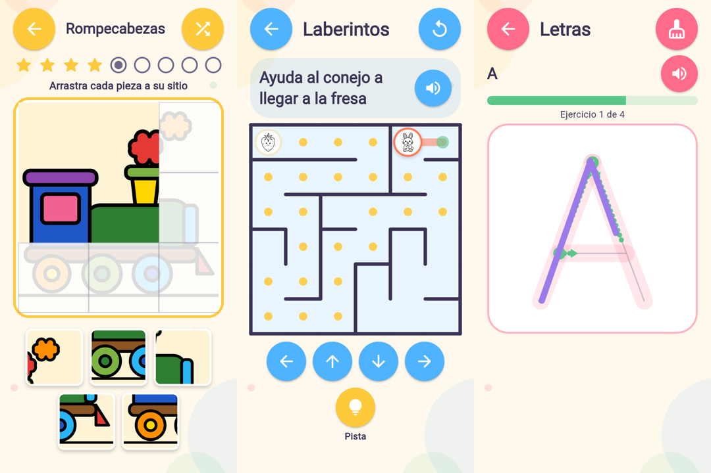

# Juegos nuevos: rompecabezas, laberintos y trazos y escritura

Tres minijuegos más en «Aprender jugando», con siete en total. Funcionan como los cuatro
anteriores:

- usan el nivel elegido (Inicial, Intermedio o Avanzado);
- dan estrellas, una felicitación y pegatinas;
- guardan el progreso en el dispositivo;
- tienen sonidos y voz;
- la música calla mientras se juega;
- no hay tiempo límite ni castigos.

*Rompecabezas de 9 piezas a medio montar, laberinto con la pista activada y la letra A
medio trazada. Son capturas de la versión web a 360 × 720 dp.*

## 1. Rompecabezas

- **Imágenes:** los 31 dibujos del catálogo (animales, vehículos, dinosaurios, frutas y
  fantasía), coloreados automáticamente con la paleta de la app. Cada partida usa un dibujo
  distinto al de la anterior, y el botón «Otro dibujo» cambia de imagen.
- **Recorte:** la imagen se ajusta al contorno del dibujo, así que casi todas las piezas tienen
  dibujo y se distinguen.
- **Piezas por nivel:** 4 (2 × 2), 9 (3 × 3) o 16 (4 × 4).
- **Cómo se juega:** las piezas se **arrastran** desde la bandeja hasta su casilla. Alternativa
  accesible: tocar una pieza y después la casilla; con lector de pantalla, cada pieza y cada
  casilla tienen nombre y acción.
- **Pieza bien colocada:** se queda fija con un pequeño salto y suena una campanita.
- **Pieza en otro sitio:** vuelve a la bandeja, el tablero se sacude suavemente y aparece
  «Esa pieza va en otro sitio». No se pierde nada.
- **Ayuda por nivel:** silueta del dibujo en el tablero, al 30 % en Inicial, al 14 % en
  Intermedio y sin silueta en Avanzado.
- **Final:** estrellas que suben, felicitación y 3, 4 o 5 estrellas según el nivel. Se gana la
  pegatina «Maestro del rompecabezas».

## 2. Laberintos

| Tema | Personaje | Meta |
|---|---|---|
| Ayuda al conejo a llegar a la fresa | conejo | fresa |
| Lleva el coche hasta la meta | coche | bandera |
| Guía a la mariposa hasta la flor | mariposa | flor |
| Encuentra el camino hacia el tesoro | dragón | diamante |

- **Recorridos generados y comprobados.** Cada laberinto es «perfecto»: entre dos casillas
  hay exactamente un camino, así que siempre se puede llegar y no hay zonas cerradas. Se
  generan con un recorrido en profundidad aleatorio.
  - La meta es la casilla más lejana de la salida, para que el recorrido sea interesante.
  - Las pruebas generan 450 laberintos y comprueban en todos que se llega a cualquier
    casilla.
- **Tamaños:** 4 × 4, 6 × 6 u 8 × 8 según el nivel. Cada partida cambia de tema.
- **Cómo se mueve el personaje:**
  - **arrastrando el dedo o el ratón**: si el dedo va deprisa, avanza casilla a casilla y se
    para en la primera pared;
  - con las **flechas**, que también sirven para teclado y lector de pantalla.
- **Paredes:** nunca se atraviesan ni se sale del laberinto. Al chocar, el personaje se sacude
  y la voz dice «¡Ahí hay una pared! Busca otro camino», como mucho una vez cada 20 s.
- **Rastro:** se dibuja el camino recorrido; volver atrás lo borra.
- **Pista (opcional):** puntos amarillos con el camino desde donde está el personaje hasta la
  meta, que se desvanecen en 3 s.
- **Empezar de nuevo:** vuelve a la salida. «Jugar otra vez» trae un laberinto nuevo.
- **Final:** estrellas, felicitación y la pegatina «Explorador de laberintos».

## 3. Trazos y escritura

| Sección | Ejercicios |
|---|---|
| Líneas | horizontal, vertical, diagonal, curva, ondas, zigzag y círculo |
| Letras | 27 mayúsculas de imprenta, de la A a la Z con la Ñ |
| Números | del 1 al 10 |
| Unir puntos | estrella, casa, corazón, pez y barco |

- **Guía:** trazo ancho y suave con una línea central, punto verde de inicio y, en los niveles
  bajos, el número de cada trazo y una flecha de dirección.
- **Dibujar:** con el dedo o el ratón. Lo ya seguido se marca en verde y la barra muestra el
  progreso.
- **Detección del seguimiento aproximado:**
  - Cada trazo se divide en puntos de control cada 2,5 % de su longitud.
  - Un punto cuenta cuando el dedo pasa cerca (según el nivel).
  - Un ejercicio se completa al cubrir la parte pedida de **cada** trazo, en cualquier orden:
    a esta edad no se exige el orden exacto.
  - Los garabatos lejos de la guía no cuentan y, si el dedo va casi siempre fuera, se anima
    con «Intenta seguir la línea».
- **Unir puntos:** hay que llegar a los puntos **en orden** (el siguiente se resalta). Al
  terminar aparece el dibujo: «¡Es una casa!».
- **Borrar:** quita lo dibujado para volver a intentarlo.
- **Al completar un ejercicio:** campanitas, un elogio y «Siguiente». Tras varios seguidos,
  la felicitación final y la pegatina «Pequeño escritor».
- **Dificultad por edad** (el nivel se elige con los botones; no se pide la edad):

  | Nivel | Edad orientativa | Tolerancia | Hay que cubrir | Orden y flechas | Ejercicios por actividad |
  |---|---|---|---|---|---|
  | Inicial | 4-5 años | 8,5 % del lienzo | 72 % | sí | 3 |
  | Intermedio | 5-6 años | 6,5 % | 80 % | sí | 4 |
  | Avanzado | 6-7 años | 5 % | 86 % | no | 5 |

## Otros cambios

- **Pegatinas:** 3 nuevas, 10 en total. «Gran explorador» pasa a pedir jugar a todos los
  juegos; quien ya la tenía la conserva.
- **Tarjetas del menú:** el título baja de tamaño antes que partir una palabra
  («Rompecabezas»).
- **Icono de obras:** la marca «Jugado N veces» del menú mostraba un icono de obras («en
  construcción»); ahora muestra una estrella. El icono de obras queda solo para «Pronto».
- **Ficha de Google Play:** descripción con los 7 minijuegos y las 10 pegatinas. Las capturas
  06 y 07 pasan a ser el rompecabezas y el laberinto; las anteriores quedan en
  `phone_extra/`.

## Archivos

- **Lógica** (sin interfaz y probada aparte), en `lib/learning/games/`: `puzzle_game.dart`,
  `maze.dart` y `tracing.dart` (incluye todos los recorridos).
- **Pantallas**, en `lib/learning/screens/`: `puzzle_game_screen.dart`,
  `maze_game_screen.dart` y `tracing_game_screen.dart`.
- **Integración:** `learning_level.dart` (nuevos `GameId`), `rewards.dart`,
  `learning_hub_screen.dart`, `learning_game_screen.dart` y `audio/phrases.dart`.
- **Componentes:** `widgets/menu_tile.dart` y `widgets/fitted_title.dart`.
- **Pruebas**, en `test/learning/`: `new_games_logic_test.dart`, `new_games_flow_test.dart` y
  ajustes en `learning_games_flow_test.dart`, `learning_progress_test.dart` y
  `test/responsive_test.dart`.

## Pruebas

**Lógica** (`new_games_logic_test.dart`):

- **Rompecabezas:** 4, 9 y 16 piezas; nunca empieza resuelto; cada pieza solo encaja en su
  casilla.
- **Laberintos:** 450 laberintos perfectos y resolubles; no se atraviesan paredes ni se sale;
  siguiendo la pista se llega; el arrastre rápido no salta paredes.
- **Trazos:**
  - los 49 ejercicios se completan trazando encima, con un pulso algo torpe, en los 3
    niveles;
  - los garabatos y la letra a medias no cuentan;
  - unir puntos exige el orden;
  - la ayuda baja con el nivel.

**En la app completa** (`new_games_flow_test.dart`):

- **Rompecabezas:** arrastrar las piezas, una pieza equivocada que vuelve, el modo «tocar y
  tocar», completar y ganar la pegatina; 9 y 16 piezas en los otros niveles.
- **Laberinto:** pared con aviso por voz, pista, recorrido con flechas y con un arrastre
  continuo del dedo, y llegada a la meta.
- **Trazos:**
  - escribir A, B y C con gestos reales, un garabato que no cuenta, borrar y terminar la
    actividad;
  - unir los puntos de la casa;
  - sin desbordamientos en teléfono pequeño con texto ×1,6, en horizontal y en tableta.

`flutter analyze` no da avisos y `flutter test` pasa **299 pruebas** (19 nuevas).

## Limitaciones

- No se ha probado en un móvil real.
- Las letras son mayúsculas de imprenta con trazos simplificados; no son letra ligada ni
  minúsculas.
- En «unir puntos», el dibujo que aparece es el contorno, sin colorear.
