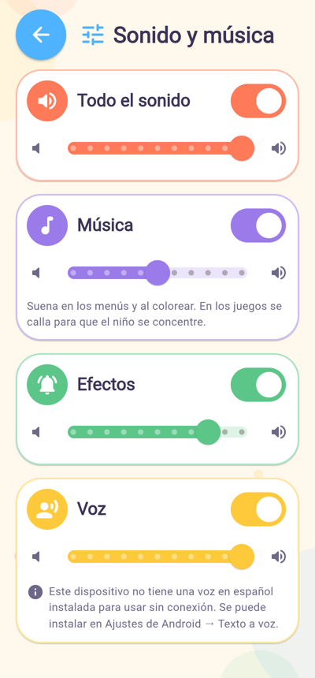

# Fase especial: sistema de sonido y música

Se amplía el audio de Fases 6–7 sin reconstruir nada:

- música de fondo original y opcional;
- una biblioteca de efectos con variantes;
- narración que no se interrumpe ni se repite;
- una pantalla «Sonido y música» con volúmenes independientes;
- comportamiento correcto al salir a segundo plano.

No hay paquetes nuevos: se siguen usando `audioplayers` y `flutter_tts`.



*Pantalla «Sonido y música» en la versión web. Este navegador de pruebas no tiene ninguna voz
en español y la pantalla lo dice tal cual.*

## 1. Diagnóstico inicial

| Parte | Antes |
|---|---|
| Efectos | 8 WAV (un archivo por acción, siempre el mismo) y un único reproductor |
| Música | No había |
| Voz | `flutter_tts` con el primer idioma español disponible, sin comprobar si funcionaba sin conexión. Sin control de «ya está hablando» ni de repeticiones |
| Volumen | Fijo (efectos 0,5 y voz 0,9) |
| Preferencias | Solo `sound_on` y `voice_on`, más el botón del inicio |
| Ciclo de vida | Se liberaba el audio al salir de «Aprender jugando». Nada al pasar a segundo plano |

## 2. Música de fondo

- **Dos bucles originales e instrumentales**, sin voces (ver `assets/audio/LICENCIAS.md`):

  | Tema | Dónde | Instrumentos | Tempo | Duración del bucle |
  |---|---|---|---|---|
  | Principal | Inicio y menús | Marimba y campanitas | 96 bpm | 40 s |
  | Colorear | Al colorear | Piano suave y campanitas | 76 bpm | 50,5 s |

- **Bucle sin cortes:** las colas de las últimas notas se suman al principio.
  - Medido sobre el Ogg ya decodificado: el salto entre el final y el principio es de
    0,001–0,003, del tamaño de un paso normal entre muestras, así que no hay chasquido.
  - La duración decodificada es exacta (40,00 s y 50,53 s), sin silencio de relleno.
- **Sin cambios bruscos:**
  - picos de −7 y −8 dBFS;
  - la sonoridad cambia de forma gradual (5–8 dB entre frases);
  - entrar, salir y bajar el volumen son fundidos de 0,8 s.
- **La música depende de la pantalla visible** (`MusicZone`, asignada en `AppRouter`):
  - la misma música en todos los menús, que no se reinicia al cambiar de pantalla;
  - la de colorear en el editor;
  - **silencio en los cuatro juegos**, que piden concentración y tienen instrucciones
    habladas;
  - al volver de un juego, la música continúa.
- **Es opcional:** tiene su interruptor y su volumen, por debajo de los efectos y la voz.
  No empieza hasta conocer las preferencias guardadas.

## 3. Efectos

| Acción | Efecto (`SoundCue`) | Variantes |
|---|---|---|
| Pulsar un botón | `tap`: clic suave | 2 |
| Seleccionar una categoría | `category`: tres notas alegres de marimba | 2 |
| Abrir un dibujo (galería o «Mis dibujos») | `open`: campanita | 2 |
| Elegir un color | `color`: una nota de xilófono **distinta por color**, en escala pentatónica | 8 |
| Colorear una zona | `pop`: «pop» suave de marimba | 3 |
| Elegir el borrador | `select`: tic breve | 1 |
| Guardar a mano | `saved`: éxito | 1 |
| Respuesta correcta | `correct`: campanitas alegres | 2 |
| Respuesta incorrecta | `tryAgain`: neutro y amable | 2 |
| Completar un juego o un dibujo | `celebrate`: pequeña celebración | 2 |
| Ganar estrellas (fin de actividad) / abrir «Mis premios» | `star`: brillo mágico | 1 |
| Desbloquear una pegatina | `reward`: celebración especial | 1 |

Cómo se evita que molesten:

- No se repite la misma variante dos veces seguidas.
- Un único reproductor: nunca suenan dos efectos a la vez.
- Las celebraciones no se cortan con un toque durante 0,9 s.
- El mismo efecto pedido dos veces en menos de 90 ms suena una sola vez (pulsaciones
  rápidas).
- Las estrellas suenan después de la celebración.
- Si hay pegatina nueva, solo suena la celebración especial.

## 4. Voz en español

- **Frases** en `lib/audio/phrases.dart`: bienvenida, coloreado, actividades y recompensas,
  como se pidió.
- **Cuándo habla.** Nunca de forma automática al abrir la app:
  - Inicio: solo si el niño **toca a Pincelín**, que también vuelve a saludar con la mano.
  - Colorear: «¡Elige tu color favorito!» con el primer dibujo de la sesión, un ánimo cuando
    el dibujo va por la mitad (una vez por dibujo) y una felicitación al terminar.
  - Juegos: la instrucción, «¡Muy bien!» o «¡Lo encontraste!» con la explicación,
    «¡Inténtalo otra vez!» y, al terminar, «¡Has completado la actividad! ¡Ganaste N
    estrellas!».
  - Pegatina nueva: «¡Ganaste una pegatina nueva!».
- **Sin interrupciones ni repeticiones** (`VoiceMode`):
  - las respuestas a lo que hace el niño cortan la frase anterior;
  - las frases de cola esperan a que termine la actual;
  - los comentarios de ambiente se descartan si ya se está hablando, si se dijo lo mismo
    hace poco o si hubo otro hace menos de 20 s;
  - las listas no repiten la última frase.
- **La música baja al 30 % mientras habla la voz** y vuelve después.
- **Funcionamiento sin conexión, comprobado en el código:**
  - En Android, `flutter_tts` informa de si cada voz necesita red (`network_required`) y de
    si está instalada (`notInstalled`). Solo se usa una voz en español **instalada y sin
    red**, con preferencia por es-PE y es-419.
  - Si no hay ninguna, la app no habla y «Sonido y música» lo explica.
- **Limitación honesta: no es una voz infantil grabada.**
  - Es la voz sintética del sistema, algo más aguda (`pitch 1.12`) y pausada (`rate 0.42`).
  - No hay grabaciones de voz con licencia en el proyecto.
  - Para tener una voz infantil real haría falta grabar las frases (unas 20) con licencia
    comercial y sustituir el `Narrator` por uno que reproduzca esos archivos.
  - En el emulador de la Fase 9, el motor de voz tardó en arrancar y la app siguió sin voz,
    sin errores.

## 5. Configuración («Sonido y música»)

- **Cómo se llega:**
  - botón de ajustes junto al altavoz en el inicio;
  - «Más ajustes» en «Aprender jugando»;
  - se menciona en la Zona para adultos.
- **Controles:**
  - **Todo el sonido**: silencio total y volumen general;
  - **Música**, **Efectos** y **Voz**: interruptor y volumen cada uno;
  - un aviso de qué voz hay, con «Probar la voz».
- **Diseño para niños:**
  - interruptores ampliados;
  - deslizadores gruesos con pasos del 10 %;
  - cada control se anuncia por separado al lector de pantalla.
- **Comportamiento:**
  - Los cambios se oyen al momento. Al soltar el deslizador se reproduce una muestra (un
    efecto o una frase).
  - El valor se **guarda al soltar** el control, no en cada movimiento.
- **Persistencia:** dentro de `learning.v1.state` (el almacenamiento existente) con nuevos
  campos: `muted`, `music_on`, `master_volume`, `music_volume`, `effects_volume` y
  `voice_volume`.
  - Los datos antiguos sin estos campos reciben los valores por defecto.
  - Los valores dañados se descartan o se recortan a 0–1.
- **Botón del altavoz del inicio:** ahora es **silencio total** (música, efectos y voz). Su
  propio clic suena antes de silenciar.

## 6. Comportamiento inteligente

| Situación | Qué pasa |
|---|---|
| Habla la voz | La música baja al 30 % y vuelve después |
| Pulsaciones rápidas | Un solo sonido; además, `guardRoute` evita abrir dos pantallas |
| Salir de una pantalla | La música pasa a la de la pantalla anterior; al salir de un juego se calla la voz |
| App en segundo plano (llamada, otra app, pantalla apagada) | La música se pausa y la voz se calla (`paused` / `hidden`); al volver (`resumed`) la música continúa. Un momento `inactive` no corta nada |
| Foco de audio en Android | La música pide el foco (pausa otras apps de música); los efectos **no** lo piden, para no cortar la música de la propia app |
| Silencio del dispositivo | iOS: categoría `ambient`, que respeta el interruptor de silencio. Android: no existe ese modo para el audio de medios; el volumen sigue al de multimedia del móvil. Se documenta como limitación |
| Recursos | Los efectos se liberan al salir de «Aprender jugando»; todo se libera al cerrar la app (`dispose`); los fundidos usan un solo temporizador que se cancela |
| Errores de audio | Se capturan: un fallo de audio nunca interrumpe la app |

## 7. Archivos

- **Nuevos:**
  - `lib/audio/`: `app_audio.dart`, `phrases.dart`, `music_zone.dart` y `ui_sounds.dart`;
  - `lib/screens/sound_settings_screen.dart`;
  - `tools/make_audio.py`;
  - `assets/audio/` (2 músicas, 27 efectos y `LICENCIAS.md`);
  - `test/audio_system_test.dart`;
  - este documento.
- **Modificados:**
  - **Aplicación y navegación:** `main.dart`, `app.dart` (enlace con el ciclo de vida),
    `app_router.dart` (música por pantalla) y `app_routes.dart` (`/sonido`).
  - **Preferencias:** `learning_progress.dart` (volúmenes) y `learning_controller.dart`
    (guardar al soltar).
  - **Componentes con sonido:** `kid_icon_button`, `menu_tile`, `big_action_button`,
    `category_card`, `drawing_card`, `color_palette_bar`, `coloring_canvas` y
    `coloring_controller` (`coloredFraction`).
  - **Pantallas y juegos:** `quiz_game_screen`, `memory_game_screen`, `activity_complete`,
    `rewards_screen`, `learning_hub_screen`, `learning_settings_bar`, `home_screen`,
    `mascot.dart` (Pincelín se puede tocar), `saved_drawings_screen` y
    `adult_zone_screen`.
  - **Pruebas:** `test/test_helpers.dart` y un ajuste en `test/motion_test.dart` (el botón
    de silencio suena antes de silenciar).
  - `pubspec.yaml`.
- **Eliminados** (sustituidos por `assets/audio/` y `tools/make_audio.py`):
  `assets/sounds/` y `tools/make_sounds.py`. Los documentos de las fases 6 y 7 los
  mencionan como historia.

## 8. Pruebas (resultados reales)

`flutter analyze` no da avisos. `flutter test` pasa **273 pruebas** (253 de antes y 20
nuevas) en tres ejecuciones seguidas.

Las nuevas, en `test/audio_system_test.dart`, comprueban:

- **Recursos:** existen todos los efectos y las músicas, son WAV y Ogg válidos, los efectos
  duran menos de 2 s y las músicas pesan menos de 400 KB.
- **Efectos:**
  - el volumen es general × efectos;
  - el silencio, el interruptor y el volumen cero los callan;
  - las pulsaciones rápidas no repiten el sonido;
  - las variantes no se repiten seguidas;
  - cada color tiene su nota.
- **Voz:**
  - una frase de ambiente no interrumpe a otra y una de cola espera su turno;
  - el ambiente no se repite;
  - `sayOneOf` no repite la última frase;
  - voz desactivada, silencio y volumen se respetan.
- **Música:**
  - suena según la pantalla y no se reinicia entre menús;
  - las preferencias la apagan, silencian o ajustan;
  - baja con la voz;
  - se pausa en segundo plano;
  - espera a cargar las preferencias;
  - se libera al cerrar.
- **Preferencias:** los datos antiguos o dañados toman valores por defecto, y guardar y
  leer devuelve lo mismo.
- **En la app completa:**
  - menús → colorear → juego → volver, con la música correcta y los sonidos de botón,
    categoría y dibujo;
  - ciclo de vida real (`handleAppLifecycleStateChanged`);
  - Pincelín saluda al tocarlo y no hay voz automática;
  - frases al colorear;
  - la pantalla de ajustes guarda las preferencias al cerrar y abrir la app.

**Verificado en el navegador** con la versión web y Playwright: el inicio pide
`main_theme.ogg`; colorear pide `coloring_theme.ogg`; los clics alternan `click_1` y
`click_2`; «Rojo» suena con `color_1`; no hay errores de página.

## 9. Limitaciones

- **No se ha oído en un móvil real.** No hay dispositivo, el emulador de la Fase 9 no era
  utilizable y aquí no se puede escuchar audio. El sonido se ha verificado con medidas sobre
  los archivos (picos, sonoridad, bucle) y con pruebas que registran qué suena. **Hay que
  escucharlo en un móvil.**
- **La voz es la del sistema**, no una voz infantil grabada (ver §4).
- **Web en Safari:** puede no reproducir Ogg Vorbis en versiones antiguas; la música no
  sonaría, sin errores. El objetivo principal es Android, donde Ogg hace bucles sin cortes.
- **Android no tiene «modo silencio» para el audio de medios.** Si el móvil está en
  silencio, la app suena según el volumen multimedia. Para silenciarla: el botón del
  altavoz.
- **Llamadas y otras apps:** la música se pausa al pasar la app a segundo plano.
  `audioplayers` no reacciona por sí solo a la pérdida del foco de audio mientras la app
  sigue en primer plano (p. ej., un asistente de voz breve).

## 10. Cómo probar

```bash
python3 tools/make_audio.py
```

```bash
flutter test
```

```bash
flutter run
```

En el móvil, comprueba que:

1. En el inicio suena una música suave; al abrir «Galería» sigue la misma, sin reiniciarse.
2. Al abrir un dibujo cambia a la música de colorear.
3. Cada color suena con una nota distinta y cada zona hace un «pop» suave.
4. En un juego la música se calla; al volver, sigue.
5. Al tocar a Pincelín, saluda (con una voz en español instalada en el móvil).
6. En «Sonido y música», cada interruptor y cada volumen se notan al momento.
7. Al cerrar y abrir la app, las preferencias se mantienen.
8. Al apagar la pantalla o ir a otra app, la música se pausa; al volver, continúa.
